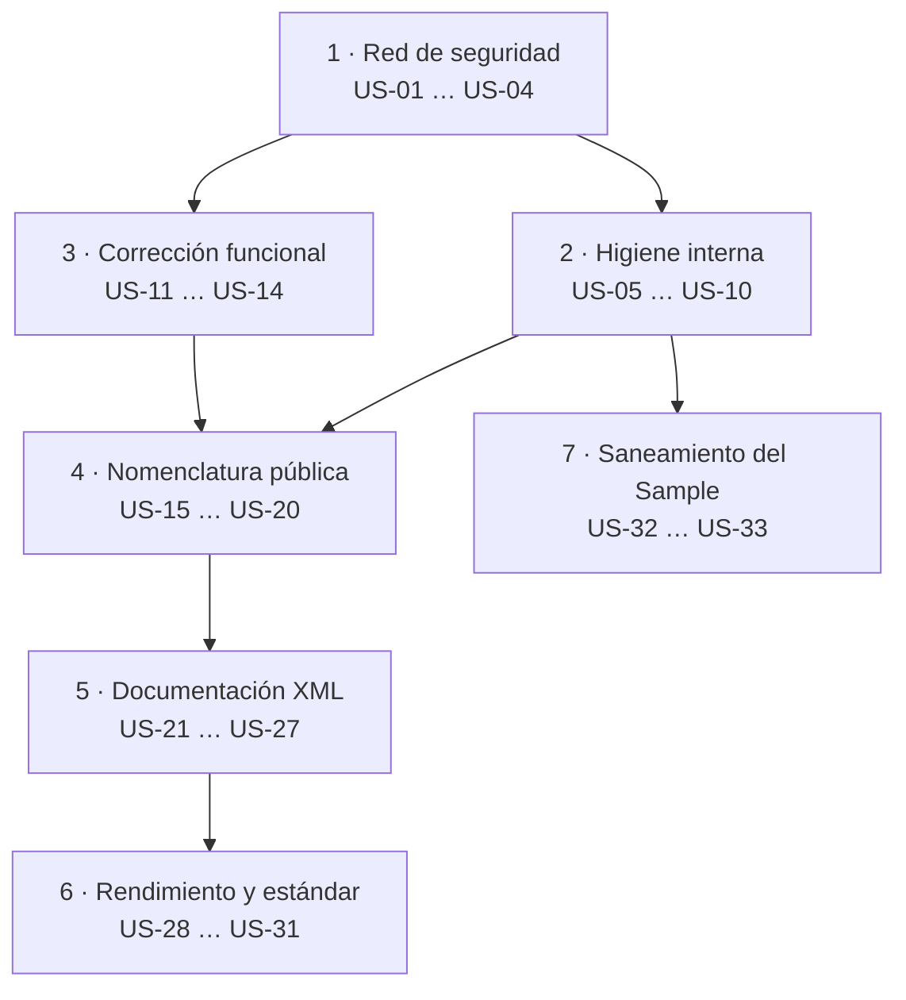

# Versión 2.2.0 · `MoralesLarios.OOFP.Logging` · Épicas de saneamiento

> **Estado global** · ⬜ ninguna épica iniciada
> **Proyectos afectados** · `src/MoralesLarios.OOFP.Logging` · `src/MoralesLarios.OOFP.Logging.Sample`
> **Origen** · [`Mejoras/Logging/README.md`](../../../Mejoras/Logging/README.md) (35 hallazgos) · [`Mejoras/Logging/01-Nomenclatura-y-Estandares.md`](../../../Mejoras/Logging/01-Nomenclatura-y-Estandares.md) (puntos 01-06)
> **Versiones destino** · 2.2.0 (todo lo aditivo, los arreglos y los puentes `[Obsolete]`) · 3.0.0 (retirada de puentes y rupturas de diseño)
> **Esfuerzo total** · ~8,5 jornadas
> **Naturaleza** · documento de planificación. No contiene cambios de código aplicados.

Esta carpeta descompone los **35 hallazgos** del análisis de `MoralesLarios.OOFP.Logging` en **7
épicas pequeñas y temáticamente cerradas**, con **33 historias de usuario** de esfuerzo XS/S/M.
Ninguna historia supera una jornada, y cada épica se puede ejecutar y cerrar de forma independiente.

El reparto agrupa los hallazgos por **la superficie que tocan**, de modo que cada épica abra un único
frente de conflicto en el control de versiones. Sigue el mismo criterio —y el mismo formato— que las
épicas ya cerradas del núcleo en [`2.1.1/Core/README.md`](../../2.1.1/Core/README.md).

---

## Índice

1. [Las siete épicas](#1-las-siete-épicas)
2. [Reparto de los hallazgos del análisis](#2-reparto-de-los-hallazgos-del-análisis)
3. [Mapa de las 33 historias](#3-mapa-de-las-33-historias)
4. [Orden de ejecución recomendado](#4-orden-de-ejecución-recomendado)
5. [Separación 2.2.0 / 3.0.0](#5-separación-220--300)
6. [Decisiones pendientes del propietario](#6-decisiones-pendientes-del-propietario)
7. [Qué queda fuera de esta carpeta](#7-qué-queda-fuera-de-esta-carpeta)
8. [Definición de terminado común](#8-definición-de-terminado-común)
9. [Ver también](#9-ver-también)

---

## 1. Las siete épicas

| # | Épica | Superficie que toca | Historias | Esfuerzo | Riesgo | Estado |
|---|-------|---------------------|:---------:|:--------:|:------:|:------:|
| 1 | [Red de seguridad](Epica-01-Red-de-Seguridad.md) | proyecto nuevo `MoralesLarios.OOFP.Logging.Tests.Unit` · `InternalsVisibleTo` | US-01 … US-04 | **L** (~2,0 j) | 🟢 | ✅ |
| 2 | [Higiene interna y código muerto](Epica-02-Higiene-Interna-y-Codigo-Muerto.md) | `GlobalUsings.cs` · `.csproj` · 530 líneas comentadas | US-05 … US-10 | **S** (~0,5 j) | 🟢 | ✅ |
| 3 | [Corrección funcional y validación](Epica-03-Correccion-Funcional-y-Validacion.md) | `MlResultLogExtensions.cs` · guardias de argumentos | US-11 … US-14 | **M** (~1,0 j) | 🟠 | ✅ |
| 4 | [Nomenclatura y firmas públicas](Epica-04-Nomenclatura-y-Firmas-Publicas.md) | 218 parámetros · `Extensions.cs` · los 7 ficheros de nivel | US-15 … US-20 | **S** (~0,5 j) | 🔴 | ⬜ |
| 5 | [Documentación XML](Epica-05-Documentacion-XML.md) | los `///` de los 339 métodos públicos | US-21 … US-27 | **M** (~1,5 j) | 🟢 | ⬜ |
| 6 | [Rendimiento y estándar de logging](Epica-06-Rendimiento-y-Estandar-de-Logging.md) | API nueva aditiva · `IsEnabled` · `EventId` · `ILogger<T>` | US-28 … US-31 | **L** (~2,0 j) | 🟡 | ⬜ |
| 7 | [Saneamiento del Sample](Epica-07-Saneamiento-del-Sample.md) | `MoralesLarios.OOFP.Logging.Sample/Program.cs` | US-32 … US-33 | **XS** (~0,25 j) | 🟢 | ⬜ |

> **Leyenda de estado** · ✅ completada · 🔄 en curso · ⬜ no iniciada

> **Leyenda de esfuerzo** · XS (<2 h) · S (½ jornada) · M (1 jornada) · L (2 jornadas) · XL (3+ jornadas)
> **Leyenda de riesgo** · 🟢 bajo · 🟡 medio · 🟠 alto · 🔴 muy alto (rompe compatibilidad)

> **Nota sobre la épica 1.** Es la **única que no arregla nada** y, a la vez, la que más valor
> aporta: hoy el proyecto tiene **339 métodos públicos y cero tests directos**. Esa ausencia no es
> una laguna de cobertura, es **la causa** de que el defecto `F1` —una llamada cruzada a
> `LogMlResultIfFailWithValueAsync` dentro de `LogMlResultIfFailWithExceptionAsync`— lleve publicado
> desde la 2.0.0 sin que nadie lo detecte. Por eso va primera: sin ella, ninguna de las épicas 3 y 4
> es demostrable.

> **Nota sobre la épica 3.** Es la única que **corrige comportamiento**, no estilo. Sus dos rupturas
> son **silenciosas**: el consumidor compila igual y obtiene un resultado distinto. Eso obliga a
> registrarlas en los **seis sitios** de
> [`oofp-upgrade-2.prompt.md`](../../../Copilot/.github/prompts/oofp-upgrade-2.prompt.md) con el
> apartado «cómo detectarla», no sólo con la fila de la tabla.

---

## 2. Reparto de los hallazgos del análisis

Cada hallazgo cae en **una sola** épica, para que no haya solapes de edición:

| Hallazgo | Resumen | Épica | Historia |
|:--------:|---------|:-----:|----------|
| F1 | `LogMlResultIfFailWithExceptionAsync` delega en `…WithValueAsync` | 3 | US-11 |
| N1 | `validBuilMessage` · falta la `d` de *Build* (134 ocurrencias) | 4 | US-15 |
| N2 | `faildMessage` · `d` de más (84 ocurrencias) | 4 | US-16 |
| N3 | `errorDetals` · falta la `i` (3 ocurrencias, lambda local) | 3 | US-13 |
| N4 | `MyMethodFinalLog` · residuo de plantilla en la API pública | 4 | US-17 |
| N5 | Clase pública llamada sólo `Extensions` | 4 | US-18 |
| N6 | Mensajes de la propia librería en inglés | 4 | US-19 |
| D1 | `ILogger.IsEnabled` nunca se consulta | 6 | US-28 |
| D2 | `logger.Log(logLevel, message)` sin plantilla ni `EventId` | 6 | US-29 |
| D3 | `null!` como valor por omisión (132 parámetros) | — | diferido a 3.0.0 |
| D4 | `ILogger` nunca genérico (0 `ILogger<T>`) | 6 | US-30 |
| D5 | Asincronía falsa · `…Async` que sólo envuelve con `.ToAsync()` | — | diferido a 3.0.0 |
| D6 | `LogMlResult` devuelve `MlResult<ILogger>` | — | diferido a 3.0.0 |
| D7 | `Match` que devuelve `null!` si el delegado es nulo | — | diferido a 3.0.0 |
| D8 | Cero validación de argumentos · `logger` nulo ⇒ `NullReferenceException` | 3 | US-12 |
| D9 | Idioma de los mensajes emitidos | 4 | US-19 |
| G1 | `using static …JavaScript.JSType` | 2 | US-05 |
| G2 | `GlobalUsings.cs` redundante con `ImplicitUsings` | 2 | US-06 |
| G3 | `.csproj` con `Label="Globals"` y 4 `Scc*` vacías | — | limpieza **transversal** · ver [§7](#7-qué-queda-fuera-de-esta-carpeta) |
| G4 | `.csproj` sin `RootNamespace` ni `InternalsVisibleTo` | 2 | US-07 |
| G5 | `.csproj` declara `AssemblyVersion` y `FileVersion` (el núcleo no) | 2 | US-08 |
| G6 | 17,5 % de líneas en blanco · bloques de 4-6 seguidas | 2 | US-10 |
| M1 | 530 líneas comentadas · el mismo bloque clonado 6 veces | 2 | US-09 |
| M2 | Errata `LogMlResultt` · 13 ocurrencias, todas comentadas | 2 | US-09 |
| X1 | `<param>` de plantilla «Mensaje descriptivo.» · 383 veces | 5 | US-21 |
| X2 | `
` con `<c></c>` vacía | 5 | US-22 |
| X3 | 603 palabras sin tildes en la documentación | 5 | US-23 |
| X4 | `<param name="validBuilMessage">` propaga la errata | 5 | US-24 |
| X5 | Cero `<exception>` y cero `<example>` en 339 métodos | 5 | US-25 |
| X6 | `<c>MlResultError</c>` y `<c>MlResultTrace</c>` · tipos que no existen | 5 | US-26 |
| X7 | `<typeparam name="TValue">Tipo del valor.</typeparam>` sin contenido | 5 | US-27 |
| T1 | No existe `MoralesLarios.OOFP.Logging.Tests.*` | 1 | US-01 … US-03 |
| S1 … S4 | Residuos de plantilla y `CS8604` del `Sample` | 7 | US-32, US-33 |

---

## 3. Mapa de las 33 historias

| Historia | Épica | Resumen | Esfuerzo | Rompe |
|----------|:-----:|---------|:--------:|:-----:|
| US-01 | 1 | Crear el proyecto `MoralesLarios.OOFP.Logging.Tests.Unit` | S | no |
| US-02 | 1 | Matriz de tests nivel × región (6 × 7) | M | no |
| US-03 | 1 | Test que fija el defecto `F1` **antes** de arreglarlo | XS | no |
| US-04 | 1 | `InternalsVisibleTo` hacia el proyecto de tests | XS | no |
| US-05 | 2 | Retirar `using static …JSType` de los 2 ficheros | XS | no |
| US-06 | 2 | Adelgazar `GlobalUsings.cs` | XS | no |
| US-07 | 2 | Añadir `RootNamespace` al `.csproj` | XS | no |
| US-08 | 2 | Homogeneizar el versionado con el del núcleo | XS | no |
| US-09 | 2 | Borrar las 530 líneas comentadas (y con ellas `LogMlResultt`) | S | no |
| US-10 | 2 | Normalizar las líneas en blanco | XS | no |
| US-11 | 3 | Arreglar `F1` · la llamada cruzada | S | **silenciosa** |
| US-12 | 3 | Validar `logger` y los constructores de mensaje | M | **silenciosa** |
| US-13 | 3 | Corregir `errorDetals` | XS | no |
| US-14 | 3 | Test de regresión de la paridad entre las tres `IfFailWith*` | S | no |
| US-15 | 4 | `validBuilMessage` → `validBuildMessage` (134) | S | compilación |
| US-16 | 4 | `faildMessage` → `failBuildMessage` (84) | S | compilación |
| US-17 | 4 | Renombrar `MyMethodFinalLog` | XS | compilación (puente) |
| US-18 | 4 | Renombrar la clase `Extensions` | XS | compilación (puente) |
| US-19 | 4 | Fijar la política de idioma de los mensajes | XS | **silenciosa** |
| US-20 | 4 | Registrar las 5 rupturas en los 6 sitios del prompt | S | — |
| US-21 | 5 | Rellenar los 383 `<param>` de plantilla | M | no |
| US-22 | 5 | Rellenar el `
` con la `<c></c>` vacía | XS | no |
| US-23 | 5 | Poner las 603 tildes que faltan | S | no |
| US-24 | 5 | Alinear los `<param>` con los nombres nuevos | XS | no |
| US-25 | 5 | Añadir `<exception>` y `<example>` representativos | M | no |
| US-26 | 5 | Corregir los `<c>` que citan tipos inexistentes | XS | no |
| US-27 | 5 | Documentar `TValue` con contenido real | XS | no |
| US-28 | 6 | Consultar `IsEnabled` antes de construir el mensaje | M | no |
| US-29 | 6 | Sobrecargas con `EventId` | M | no |
| US-30 | 6 | Sobrecargas con `ILogger<T>` | S | no |
| US-31 | 6 | Medir el coste antes y después | S | no |
| US-32 | 7 | Limpiar los residuos de plantilla del `Sample` | XS | no |
| US-33 | 7 | Resolver el `CS8604` del `Sample` | XS | no |

**Total: 33 historias.** Rupturas: **2 silenciosas** en la épica 3, **4 de compilación + 1
silenciosa** en la épica 4.

---

## 4. Orden de ejecución recomendado

**Justificación del orden.**

1. **La épica 1 va primera y no se negocia.** Arreglar `F1` sin tests es cambiar comportamiento a
   ciegas; renombrar 218 parámetros sin tests es confiar en que el compilador lo vea todo, y en una
   ruptura silenciosa el compilador no ve nada.
2. **La épica 2 va antes que la 4** porque retira 530 líneas comentadas que contienen **102 firmas
   `public static`** y las 13 ocurrencias de `LogMlResultt`. Si se renombra antes de limpiar, cada
   búsqueda de impacto obliga a filtrar código muerto a mano.
3. **Las rupturas se concentran en las épicas 3 y 4**, que son las dos que obligan a registrar puntos
   nuevos en el prompt de migración. Juntarlas en el tiempo permite un único repaso del contrato.
4. **La épica 5 va después de la 4** porque la documentación cita los nombres de los parámetros: si
   se redacta antes del renombrado, hay que volver a tocarla.
5. **La épica 7 es independiente** de todo lo demás y puede hacerse en cualquier momento tras la 2.

---

## 5. Separación 2.2.0 / 3.0.0

| Va en la 2.2.0 | Va en la 3.0.0 |
|----------------|----------------|
| Épicas 1, 2, 3, 5, 7 completas | Retirada de los puentes `[Obsolete]` de la épica 4 |
| Épica 4 con **puentes `[Obsolete]`** donde sea posible | Retirada de los 6 puentes heredados de la 2.0.0 |
| Épica 6 en su parte **aditiva** (sobrecargas nuevas) | D5 · retirar la asincronía falsa |
| — | D6 · dejar de devolver `MlResult<ILogger>` (ruptura binaria) |
| — | D3 y D7 · sustituir los 132 `null!` por sobrecargas reales |

> ⚠️ **Los puentes no siempre son posibles.** En C# **no se puede** publicar dos nombres para el
> mismo parámetro: un renombrado de parámetro rompe a todo consumidor que use argumentos con nombre
> y **no admite puente**. Eso convierte a las US-15 y US-16 en el punto más delicado del plan y es
> justamente el objeto de la decisión [D-04](#6-decisiones-pendientes-del-propietario).

---

## 6. Decisiones pendientes del propietario

| # | Decisión | Opciones | Estado |
|:-:|----------|----------|:------:|
| **D-01** | Nombre nuevo de `MyMethodFinalLog` | (a) `LogActionResult` · (b) `LogMethodOutcome` · (c) `LogCompletedAction` · (d) retirarlo y que el consumidor use `LogCompletedResult` | ⬜ abierta |
| **D-02** | Nombre nuevo de la clase `Extensions` | (a) `MlResultLogActionExtensions` · (b) `MlResultMethodLogExtensions` · (c) fusionar su contenido en `MlResultLogExtensions` como otro `partial` | ⬜ abierta |
| **D-03** | Idioma de los mensajes que emite la librería | (a) castellano · (b) inglés · (c) no emitir texto propio | ⬜ abierta |
| **D-04** | Estrategia para los 218 parámetros renombrados | (a) sobrecarga nueva + antigua `[Obsolete]` · (b) renombrado directo aceptando la ruptura · (c) renombrado directo en la 2.2.0 asumiendo que el uso de argumentos con nombre es minoritario | ⬜ abierta |
| **D-05** | Alcance de la matriz de tests de la épica 1 | (a) las 339 firmas · (b) una por región y nivel (42 casos) + los bordes · (c) sólo las 7 regiones del nivel `Error` | ⬜ abierta |
| **D-06** | Qué hacer cuando `logger` es nulo (US-12) | (a) `ArgumentNullException` · (b) devolver un `MlResult` fallido · (c) no registrar y devolver el `source` intacto | ⬜ abierta |
| **D-07** | Doble de `ILogger` para el proyecto de tests (US-02) | (a) escribirlo a mano · (b) usar una librería de dobles ya referenciada en la solución · (c) usar el proveedor en memoria de `Microsoft.Extensions.Logging` | ⬜ abierta |
| **D-08** | Qué hacer con el test de `F1` hasta que se arregle (US-03) | (a) `Skip` con referencia a la US-11 · (b) afirmar el comportamiento **actual** y cambiarlo al arreglarlo · (c) dejarlo en rojo | ⬜ abierta |

> **D-04 y D-06 son las dos decisiones que condicionan el plan.** La primera determina si la épica 4
> cabe en una 2.2.0 o tiene que esperar a la 3.0.0. La segunda determina si la US-12 es una ruptura
> silenciosa (opciones a y b) o un cambio inocuo (opción c).

> **Numeración.** Los identificadores `D-NN` son **estables**: se citan por número desde los
> documentos de las épicas y **no se reordenan ni se reutilizan** aunque queden huecos.

---

## 7. Qué queda fuera de esta carpeta

| Asunto | Motivo | Dónde va |
|--------|--------|----------|
| **G3 · el bloque `Scc*` de los `.csproj`** | aparece en **28 `.csproj`** de la solución, no sólo en Logging | commit transversal propio `chore(build)`, independiente de estas épicas |
| **D3, D5, D6, D7** | rupturas de diseño que no admiten puente | 3.0.0 · ver [§5](#5-separación-220--300) |
| **Los 4 avisos `CS8604` de `EnsureFp.Strings.cs`** | son del núcleo, no de Logging | [`Mejoras/Core/README.md`](../../../Mejoras/Core/README.md) §5.1 |
| **`MoralesLarios.OOFP.Extensions.Loggers`** | **no existe en disco**: era una carpeta fantasma del árbol del espacio de trabajo | — |

---

## 8. Definición de terminado común

Aplica a **todas** las historias de todas las épicas de esta carpeta:

- [ ] `dotnet build MoralesLarios.OOFP.sln -c Release --no-incremental` → **EXIT = 0**, **0 errores**,
      **0 `CS1591`**, **0 `CS0618`** y **no más de 236 avisos**.
- [ ] `dotnet test MoralesLarios.OOFP.sln -c Release --no-build` → **1.136 tests** en verde, más los
      nuevos de la épica 1.
- [ ] Toda ruptura está registrada en los **seis sitios** de
      [`oofp-upgrade-2.prompt.md`](../../../Copilot/.github/prompts/oofp-upgrade-2.prompt.md): fila de
      la §3.3, subsección `#### N`, barrido de la Fase 5, lista de la Fase 6, tabla del apéndice y
      —si hay renombrado— [`oofp-upgrade-2.renames.md`](../../../Copilot/.github/prompts/oofp-upgrade-2.renames.md).
- [ ] Las rupturas **silenciosas** incluyen en su registro **cómo detectarlas**, con un patrón de
      búsqueda aplicable al código del consumidor.
- [ ] El criterio de aceptación correspondiente está marcado en el documento de la épica.
- [ ] El commit sigue *Conventional Commits* en castellano, con `!` si rompe algo, creado con
      `git commit -F` desde un fichero UTF-8 sin BOM.

> ⚠️ **Obligatorio.** El registro en el prompt de migración se hace **en la misma tanda de cambios**
> que el código, nunca «al final de la épica».

---

## 9. Ver también

- [`Mejoras/Logging/README.md`](../../../Mejoras/Logging/README.md) — el análisis que origina estas épicas, con los 35 hallazgos medidos.
- [`Mejoras/Logging/01-Nomenclatura-y-Estandares.md`](../../../Mejoras/Logging/01-Nomenclatura-y-Estandares.md) — detalle de los 6 puntos de nomenclatura que alimentan la épica 4.
- [`2.1.1/Core/README.md`](../../2.1.1/Core/README.md) — las épicas ya cerradas del núcleo, modelo de formato de esta carpeta.
- [`oofp-upgrade-2.prompt.md`](../../../Copilot/.github/prompts/oofp-upgrade-2.prompt.md) — contrato de migración del consumidor.
- [`oofp-upgrade-2.renames.md`](../../../Copilot/.github/prompts/oofp-upgrade-2.renames.md) — anexo de renombrados.
