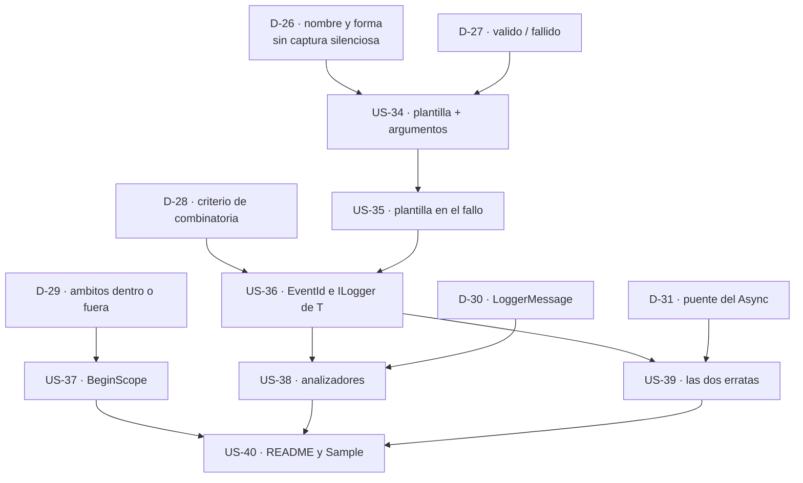

# Épica 8 · Registro estructurado y plantillas de mensaje: devolverle los campos al consumidor

> **Versión destino** · 2.3.0 (US-34 … US-40)
> **Origen** · petición del propietario · hallazgo `D2` del análisis, diferido en la [épica 6](../../2.2.0/Logging/Epica-06-Rendimiento-y-Estandar-de-Logging.md)
> **Plan del que se desgaja** · [`README.md`](README.md) de la versión 2.3.0
> **Proyecto** · `src/MoralesLarios.OOFP.Logging`
> **Estado** · ⬜ no iniciada
> **Esfuerzo** · **XL** (~3,5 jornadas)
> **Riesgo** · 🟠 alto · la US-34 puede crear una **captura silenciosa de llamadas existentes** si se resuelve mal (ver [`D-26`](#5-decisiones-abiertas))
>
> **Leyenda de esfuerzo:** XS (<2 h) · S (½ jornada) · M (1 jornada) · L (2 jornadas) · XL (3+ jornadas)
> **Leyenda de riesgo:** 🟢 bajo · 🟡 medio · 🟠 alto · 🔴 muy alto (rompe compatibilidad)

---

## Índice

1. [Contexto y problema](#1-contexto-y-problema)
   - [Punto 29 — El registro estructurado se pierde por el camino](#punto-29--el-registro-estructurado-se-pierde-por-el-camino)
   - [Punto 30 — La prueba de la ambigüedad y la captura silenciosa](#punto-30--la-prueba-de-la-ambigüedad-y-la-captura-silenciosa)
   - [Punto 31 — Los dos ejes de la 2.2.0 no se combinan](#punto-31--los-dos-ejes-de-la-220-no-se-combinan)
   - [Punto 32 — Cero BeginScope: no hay forma de correlacionar](#punto-32--cero-beginscope-no-hay-forma-de-correlacionar)
   - [Punto 33 — Dos erratas que sobrevivieron a la 2.2.0](#punto-33--dos-erratas-que-sobrevivieron-a-la-220)
2. [Alcance](#2-alcance)
3. [Historias de usuario](#3-historias-de-usuario)
4. [Orden de ejecución](#4-orden-de-ejecución)
5. [Decisiones abiertas](#5-decisiones-abiertas)
6. [Definición de terminado](#6-definición-de-terminado)
7. [Apéndice · la prueba de resolución de sobrecargas](#7-apéndice--la-prueba-de-resolución-de-sobrecargas)
8. [Ver también](#8-ver-también)

---

## 1. Contexto y problema

La [épica 6](../../2.2.0/Logging/Epica-06-Rendimiento-y-Estandar-de-Logging.md) arregló **cuándo** se
registra —el `IsEnabled` perezoso— y añadió los dos ejes que faltaban: `EventId` e
`ILogger<TCategory>`. Pero dejó fuera, explícitamente, el hallazgo `D2`: **cómo** se registra. Su §2
decía:

> *«Arreglar `CA2254` de verdad exige que el consumidor entregue **plantilla + argumentos** en lugar
> de un `string` ya montado, y eso cambia la firma de los 339 métodos públicos. Es una ruptura de
> otro orden de magnitud: pertenece a la 3.0.0.»*

Esta épica demuestra que ese diagnóstico era **demasiado pesimista**. No hace falta cambiar ninguna
firma: basta **añadir** una familia de sobrecargas que acepte la plantilla. La ruptura desaparece y
la capacidad llega en una versión menor.

Superficie de partida, medida sobre el proyecto tal como quedó tras la 2.2.0:

| Fichero | Firmas públicas | Regiones |
|---------|----------------:|---------:|
| `MlResultLogExtensions.cs` | 57 | 7 |
| `MlResultLogExtensions.Trace.cs` | 46 | 6 |
| `MlResultLogExtensions.Debug.cs` | 46 | 6 |
| `MlResultLogExtensions.Information.cs` | 46 | 6 |
| `MlResultLogExtensions.Warning.cs` | 46 | 6 |
| `MlResultLogExtensions.Error.cs` | 46 | 6 |
| `MlResultLogExtensions.Critical.cs` | 46 | 6 |
| `MlResultLogExtensions.EventId.cs` | 35 | 7 |
| `MlResultLogExtensions.Categoria.cs` | 21 | 7 |
| `MlResultLogExtensions.Obsolete.cs` | 5 | 0 |
| `MlResultLogActionExtensions.cs` | 2 | 0 |
| `MlResultLogActionExtensions.Obsolete.cs` | 2 | 0 |
| **Total** | **398** | — |

Y el estado del estándar de `Microsoft.Extensions.Logging` después de la 2.2.0:

| Elemento del estándar | Antes de la 2.2.0 | Hoy | Tras esta épica |
|-----------------------|------------------:|----:|----------------:|
| `ILogger.IsEnabled` | 0 | 7 | 7 |
| `EventId` | 0 | 123 | > 123 |
| `ILogger<T>` | 0 | 21 firmas | > 21 |
| **Plantilla de mensaje con argumentos** | **0** | **0** | **objetivo** |
| `BeginScope` | 0 | **0** | ver [`D-29`](#5-decisiones-abiertas) |
| `LoggerMessage` (generación de código) | 0 | **0** | ver [`D-30`](#5-decisiones-abiertas) |

Dos ceros siguen ahí. Esta épica ataca el primero, que es el que el consumidor nota todos los días.

### Punto 29 — El registro estructurado se pierde por el camino

Éste es el hallazgo central. Hoy, todos los caminos acaban en el mismo sitio:

```csharp
// MoralesLarios.OOFP.Logging/MlResultLogExtensions.cs, L22-32
public static MlResult<ILogger> LogMlResult(this ILogger  logger,
                                                 LogLevel logLevel,
                                                 string   message)
{
    if (logger  is null) return MlResultLogGuards.NullLoggerFail();
    if (message is null) return logger.ToMlResultValid();

    logger.Log(logLevel, message);

    return logger.ToMlResultValid();
}
```

`message` llega **ya montado**. El consumidor lo construyó con una interpolación:

```csharp
origen.LogMlResultInformation(logger, validBuildMessage: p => $"Pedido {p.Id} del cliente {p.ClienteId} confirmado");
```

Y lo que recibe el *sink* —`Serilog`, `OpenTelemetry`, `Application Insights`— es **una cadena
opaca**:

```text
Pedido 4711 del cliente 912 confirmado
```

No hay campos. No se puede consultar «dame todas las trazas del cliente 912», ni agrupar por
`PedidoId`, ni poner una alerta sobre un valor. El consumidor pagó por un sistema de registro
estructurado y nuestra librería lo degrada a texto plano. Con **398 firmas públicas**, no hay **ni
una** por la que pueda entrar un campo.

Lo que el estándar espera es que la plantilla y los valores viajen **separados**:

```csharp
logger.Log(logLevel, "Pedido {PedidoId} del cliente {ClienteId} confirmado", p.Id, p.ClienteId);
```

Y entonces el *sink* recibe las dos cosas: el texto renderizado **y** el diccionario
`{ PedidoId = 4711, ClienteId = 912 }`.

La petición del propietario lo resume en una línea:

```csharp
.LogMlResultInformation("hola a las {hora}", DateTime.Now)
```

> **Matiz de sintaxis.** En `Microsoft.Extensions.Logging` los marcadores de la plantilla son
> **nombres de propiedad**, no índices, pero se rellenan **por posición**. `{hora}` no busca una
> variable llamada `hora`: toma el primer elemento de `args`. Por convención se escriben en
> `PascalCase` —`{Hora}`—, porque el nombre acaba siendo la **clave** del campo estructurado. El
> ejemplo correcto, por tanto, es `.LogMlResultInformation(logger, "hola a las {Hora}", DateTime.Now)`.

### Punto 30 — La prueba de la ambigüedad y la captura silenciosa

La objeción evidente a añadir `params object?[]` es que choque con las sobrecargas que ya existen. En
la familia `LogMlResultInformation` conviven hoy tres formas sobre `MlResult<T>`:

```csharp
// 1 · constructores de mensaje
LogMlResultInformation<T>(this MlResult<T> source, ILogger logger,
                          Func<T, string> validBuildMessage = null!,
                          Func<MlErrorDetails, string> failBuildMessage = null!)

// 2 · dos mensajes literales
LogMlResultInformation<T>(this MlResult<T> source, ILogger logger,
                          string validMessage = null!, string failMessage = null!)

// 3 · un mensaje literal
LogMlResultInformation<T>(this MlResult<T> source, ILogger logger, string message)
```

Se ha **comprobado experimentalmente** —no deducido— qué ocurre al añadir una cuarta
`(..., string template, params object?[] args)`. El resultado está en la [§7](#7-apéndice--la-prueba-de-resolución-de-sobrecargas):

| Llamada | Sobrecarga elegida | ¿Es la que el consumidor espera? |
|---------|--------------------|:--------------------------------:|
| `("solo texto")` | 3 · un literal | ✅ |
| `("válido", "fallido")` | 2 · dos literales | ✅ |
| `("hola a las {Hora}", DateTime.Now)` | 4 · plantilla | ✅ |
| `("{A} y {B}", 1, 2)` | 4 · plantilla | ✅ |
| `(v => …, e => …)` | 1 · constructores | ✅ |

**Cero errores de compilación** y la resolución elige lo correcto en los cinco casos. La sobrecarga
sin `params` siempre gana cuando encaja exactamente, que es precisamente lo que protege al código ya
escrito.

Pero hay un caso que **no** aparece en esa tabla y es el peligroso:

```csharp
origen.LogMlResultInformation(logger, "hola a las {Hora}", "las nueve");
```

El consumidor cree estar pasando **plantilla + un argumento `string`**. El compilador ve dos `string`
y elige la **sobrecarga 2**: `validMessage` = la plantilla, `failMessage` = el argumento. Resultado:
se registran **dos trazas literales con las llaves sin sustituir**, en lugar de una traza
estructurada. Compila, no avisa, y hace otra cosa.

> **Esto es el nudo de la épica.** La ambigüedad no es de compilador, es **de intención**, y sólo
> aparece cuando el único argumento de la plantilla es un `string`. Que es, estadísticamente, el caso
> más frecuente. Decidirlo es [`D-26`](#5-decisiones-abiertas), y de esa decisión depende el nombre de
> todo lo que se añade en esta épica.

### Punto 31 — Los dos ejes de la 2.2.0 no se combinan

La 2.2.0 añadió dos ejes en ficheros separados, y el `README.md` del proyecto lo documenta con una
nota al pie: **no se combinan**.

| Fichero | Eje | Firmas |
|---------|-----|-------:|
| `MlResultLogExtensions.EventId.cs` | `ILogger` + `EventId` | 35 |
| `MlResultLogExtensions.Categoria.cs` | `ILogger<TCategory>` | 21 |

No existe ninguna firma que acepte `ILogger<TCategory>` **y** `EventId`. El consumidor que inyecta un
`ILogger<MiServicio>` y quiere filtrar por evento tiene que elegir: o la categoría o el `EventId`. Al
añadir un tercer eje —la plantilla— el problema se multiplica: sin un criterio explícito, la
combinatoria 3 ejes × 7 familias × 6 niveles × 3 formas asíncronas es inabordable.

Esta épica no pretende cerrar la combinatoria completa; pretende **fijar el criterio** de qué
combinaciones se ofrecen y por qué, y dejarlo escrito para las épicas siguientes
([`D-28`](#5-decisiones-abiertas)).

### Punto 32 — Cero BeginScope: no hay forma de correlacionar

`ILogger.BeginScope` es el mecanismo del estándar para que **varias** trazas compartan contexto: se
abre un ámbito con unas propiedades y todo lo que se registre dentro las lleva. Es lo natural en una
librería como ésta, donde el consumidor encadena operaciones:

```csharp
origen.Bind(Validar)
      .LogMlResultInformation(logger, "validado")
      .Bind(Guardar)
      .LogMlResultInformation(logger, "guardado")
      .LogMlResultErrorIfFail(logger, errors => errors.GetErrorsSummary());
```

Las tres trazas pertenecen a la misma operación lógica y **nada** las une: ni un `CorrelationId`, ni
un ámbito. El recuento de `BeginScope` en el proyecto es **0**.

La forma idiomática en el estilo de la librería sería un método que abra el ámbito, ejecute un tramo
de la tubería y lo cierre:

```csharp
origen.WithLogScope(logger, "{Operacion} de {ClienteId}", "AltaPedido", clienteId,
                    pipeline: r => r.Bind(Validar).Bind(Guardar));
```

Es una pieza de diseño mayor que la US-34, y por eso va a decisión aparte
([`D-29`](#5-decisiones-abiertas)): puede entrar aquí o desgajarse a su propia épica.

### Punto 33 — Dos erratas que sobrevivieron a la 2.2.0

Las siete épicas de la 2.2.0 dejaron dos cosas conscientemente anotadas como pendientes, y el
`README.md` del proyecto las recoge en su apartado «Lo que queda por limpiar en la 3.0.0»:

1. **Región mal etiquetada.** En `MlResultLogExtensions.Trace.cs` hay una `#region` que se llama
   `LogMlResultCritical`. Es un copia-pega: el contenido es de `Trace`. No afecta al consumidor, pero
   rompe el test de paridad de nombres de región si alguien lo endurece.
2. **Un `Async` que falta.** Existe una sobrecarga
   `async Task<MlResult<T>> LogCompletedResult<T>(this Task<MlResult<T>> …)` **sin** el sufijo
   `Async`, en contra del convenio que la [épica 4](../../2.2.0/Logging/Epica-04-Nomenclatura-y-Firmas-Publicas.md)
   fijó para toda la librería.

La primera se arregla gratis. La segunda **no es gratis**: añadir el nombre correcto y marcar el
antiguo `[Obsolete]` genera `CS0618` en el consumidor, que es una ruptura registrable. Entra aquí si
[`D-31`](#5-decisiones-abiertas) lo aprueba; si no, espera a la 3.0.0.

---

## 2. Alcance

**Entra en esta épica:**

- Una familia nueva de sobrecargas que acepta **plantilla de mensaje + argumentos**, para las siete
  familias y los seis niveles, en sus tres formas (síncrona, `MlResult` → `Task`, `Task` → `Task`).
- La misma capacidad en la **rama de fallo**, no sólo en la válida.
- La combinación de la plantilla con los ejes `EventId` e `ILogger<TCategory>`, con el criterio que
  fije [`D-28`](#5-decisiones-abiertas).
- Respeto estricto de los dos invariantes que la 2.2.0 estableció: el **cortocircuito `IsEnabled`** y
  la **política de `logger` nulo** de `D-06` —no registrar y devolver el `source` intacto—.
- Documentación XML completa, sección nueva en el `README.md` del proyecto y tests.
- Las dos erratas del punto 33.

**No entra en esta épica:**

| Asunto | Dónde va |
|--------|----------|
| `D3` · los `null!` como valor por omisión | **3.0.0** |
| `D5` · asincronía de adorno (`…Async` que sólo envuelve con `.ToAsync()`) | **3.0.0** |
| `D6` · `LogMlResult` devolviendo `MlResult<ILogger>` | **3.0.0** |
| `D7` · `Match` devolviendo `null!` | **3.0.0** |
| Retirar los puentes `[Obsolete]` de la 2.2.0 | **3.0.0** |
| `BeginScope` | **aquí o épica propia** · ver [`D-29`](#5-decisiones-abiertas) |
| `LoggerMessage.Define` y la generación de código | **aquí o 3.0.0** · ver [`D-30`](#5-decisiones-abiertas) |

> **Por qué esto no rompe nada, a diferencia de lo que suponía la épica 6.** Porque **no se modifica
> ninguna firma existente**: se añaden sobrecargas nuevas. La prueba del punto 30 lo confirma con
> código compilado, no con un razonamiento. La única ruptura posible es la **captura silenciosa** del
> caso de un solo argumento `string`, y `D-26` existe precisamente para eliminarla por diseño.

---

## 3. Historias de usuario

### US-34 · Sobrecargas con plantilla de mensaje y argumentos

**Como** consumidor con `Serilog` u `OpenTelemetry` detrás
**quiero** pasar una plantilla con marcadores y sus valores por separado
**para** que mis trazas lleguen al *sink* con campos consultables, no como una cadena opaca.

- **Esfuerzo** · L · **Riesgo** · 🟡 · **Rompe** · no · familia **`…Template`** por [`D-26`](#5-decisiones-abiertas)

**Criterios de aceptación**

- [x] **Resuelta [`D-26`](#5-decisiones-abiertas)** · opción **(a)** con el sufijo **`Template`**: al
      no compartir nombre con las sobrecargas de `string`, la **captura silenciosa** del punto 30 es
      **imposible**, no improbable.
- [x] **Resuelta [`D-27`](#5-decisiones-abiertas)** · opción **(c)**: esta historia cubre **sólo la
      rama válida**; la fallida es la US-35.
- [x] Existe al menos una sobrecarga por nivel que acepta `string messageTemplate` y los argumentos,
      y delega en `ILogger.Log(logLevel, messageTemplate, args)` **sin** interpolar previamente.
      **Hecho**: `MlResultLogExtensions.Template.cs` aporta el núcleo neutral (5 firmas) y cada uno
      de los seis ficheros de nivel aporta 5 delegaciones de una línea ⇒ **35 firmas nuevas**
      (398 → 433 firmas públicas en el proyecto).
- [x] Hay un **test con doble de `ILogger`** que verifica que el `state` recibido implementa
      `IReadOnlyList<KeyValuePair<string, object?>>` y **contiene los campos con sus nombres**:
      para `"hola a las {Hora}"` debe existir la clave `Hora`. Éste es el test que demuestra la
      épica: sin él, nada prueba que el registro sea realmente estructurado.
      **Hecho**: `LogMlResultInformationTemplate_PublicaElMarcadorComoCampoEstructurado`, apoyado en
      el nuevo doble `Support/StructuredLoggerSpy.cs` (el `LoggerSpy` anterior aplanaba el `state` y
      hacía imposible esta comprobación; se ha añadido uno nuevo sin tocar el existente).
- [x] Hay un **test** que verifica que `{OriginalFormat}` llega con la **plantilla sin sustituir**.
      **Hecho**: `…EntregaLaPlantillaSinSustituirEnOriginalFormat`, y
      `…RellenaLosMarcadoresPorPosicion` fija además el matiz del relleno **por posición**.
- [x] Se respeta el **cortocircuito `IsEnabled`**: con el nivel apagado no se llama a `logger.Log`
      **ni se evalúa nada**; hay un test que lo afirma. **Hecho**: con `MinimumLevel = Error` el
      doble no recibe ninguna traza y `IsEnabledCallCount` vale exactamente 1.
- [x] Se respeta la **política `D-06`**: con `logger` nulo se devuelve el `source` intacto y no se
      lanza nada; hay un test que lo afirma.
- [x] Se respeta la política de argumentos nulos: `messageTemplate` nulo ⇒ no se registra nada y se
      devuelve el `source`, igual que hacen hoy las sobrecargas de `message`. También se cubre el
      caso de `args` nulo.
- [x] Ninguna firma existente se modifica, **ni añadiéndole un parámetro opcional**: sería una
      ruptura binaria (§4 de `commits-conventional-y-registro.instructions.md`). **Hecho**: todo el
      trabajo es aditivo; el recuento por fichero sólo crece (+5 por nivel, +5 del núcleo).
- [x] Se compila un **caso de prueba por cada una de las 5 formas de llamada** de la tabla del punto
      30, sin nombres de parámetro, verificando que sigue resolviéndose a la sobrecarga de siempre.
      **Hecho**: `LasCincoFormasDeLlamadaExistentes_SiguenResolviendoALasSobrecargasAntiguas` y
      `LaSobrecargaDeDosMensajes_NoSeConfundeConUnaPlantillaMasArgumento` no sólo compilan: afirman
      sobre lo que recibe el doble, que es lo único que demuestra a **qué** sobrecarga se resolvió.
- [x] Documentación XML completa en cada miembro nuevo, con al menos un `<example>` por familia, y
      build con **0 `CS1591`**. **Hecho**: build en Release `EXIT = 0`, 0 errores, 236 avisos (el
      mismo recuento que antes de la historia ⇒ ningún aviso nuevo), `CS1591 = 0`, `CS0618 = 0`.
- [x] **Registrada como aditivo relevante** en los 6 sitios del prompt de migración: no rompe, pero
      es la capacidad más visible de la versión y el consumidor debe saber que existe.
      **Hecho** como **punto 53**: fila de la tabla §3.3, subsección `#### 53`, barrido de la Fase 5
      punto 4, informe de la Fase 6 punto 5 y fila nueva `2.3.0` del apéndice con su nota de salto de
      versión. El anexo `oofp-upgrade-2.renames.md` **no** aplica: la historia no renombra nada.

> ✅ **US-34 cerrada.** Tests: 1397 → **1423** (+26, todos verdes, 0 con error, 0 omitidos).
> Anclas markdown: `revisados = 1308  rotos = 0`.

### US-35 · Plantilla en la rama de fallo

**Como** consumidor que vigila los errores
**quiero** que el camino de fallo también emita campos
**para** poder alertar sobre `{CodigoError}` sin analizar texto.

- **Esfuerzo** · M · **Riesgo** · 🟡 · **Rompe** · no

**Criterios de aceptación**

- [ ] Las familias `…IfFail`, `…IfFailWithValue`, `…IfFailWithException` y
      `…IfFailWithoutException` tienen su variante con plantilla.
- [ ] Queda resuelto, y escrito, **de dónde salen los argumentos** en la rama de fallo: los aporta el
      llamante, o se derivan del `MlErrorDetails`, o ambas cosas con sobrecargas distintas.
- [ ] Si se derivan del `MlErrorDetails`, los nombres de campo quedan **fijados y documentados**
      —p. ej. `{ErrorMessage}`, `{ErrorCount}`, `{ExceptionType}`—, porque pasan a ser **contrato**:
      cambiarlos después sería una ruptura silenciosa.
- [ ] Hay tests que verifican los campos de la rama de fallo con el doble de `ILogger`.
- [ ] Se conserva la **paridad de recuentos** por fichero de nivel que la épica 1 vigila en
      `MatrixTests.cs`, y los dos tests de matriz se actualizan con los recuentos nuevos **en el
      mismo commit** que añade las sobrecargas.
- [ ] Documentación XML completa y **registro en el prompt de migración**.

### US-36 · Combinar la plantilla con EventId y con ILogger de T

**Como** consumidor que usa inyección de dependencias y filtra por evento
**quiero** no tener que elegir entre la categoría, el `EventId` y los campos
**para** poder usar las tres cosas en la misma llamada.

- **Esfuerzo** · M · **Riesgo** · 🟡 · **Rompe** · no

**Criterios de aceptación**

- [x] **Resuelta [`D-28`](#5-decisiones-abiertas)** · opción **(b)**: se cruzan el genérico, los 6
      niveles y el eje `EventId`; el cruce con `ILogger<TCategory>` **queda fuera de alcance**.
- [ ] Ese criterio queda escrito en el `README.md` del proyecto, sustituyendo la nota actual de «los
      dos ejes no se combinan».
- [ ] Existen las combinaciones que `D-28` apruebe, y **sólo** ésas: la épica no añade firmas «por
      simetría» que nadie va a llamar.
- [ ] Se verifica que las combinaciones nuevas **no** generan ambigüedad, compilando una llamada de
      cada una **sin nombres de parámetro** y con un `ILogger<Program>` sin *casting*.
- [ ] El recuento de firmas públicas antes y después queda escrito en la §7, con el desglose por
      fichero, igual que la tabla de la §1.
- [ ] Documentación XML completa y **registro en el prompt de migración**.

### US-37 · Decidir y, si procede, implementar los ámbitos de registro

**Como** consumidor que encadena operaciones en una tubería
**quiero** que las trazas de una misma operación compartan contexto
**para** poder reconstruir el recorrido completo desde el *sink*.

- **Esfuerzo** · L · **Riesgo** · 🟠 · **Rompe** · no

**Criterios de aceptación**

- [x] **Resuelta [`D-29`](#5-decisiones-abiertas)** · opción **(b)**: los ámbitos **se desgajan a una
      épica 9 propia**. Por tanto esta historia **no produce código**.
- [ ] Existe el documento de la **épica 9**, con sus historias numeradas **desde la US-41** y con las
      preguntas propias de los ámbitos planteadas: qué pasa si el tramo lanza, cómo se compone con
      `Bind`, y si el ámbito debe sobrevivir al `await`.
- [ ] El recuento de `BeginScope` en el proyecto queda documentado como `0` **con la justificación**
      —se aborda en la épica 9— en el `README.md` del proyecto.

### US-38 · Dejar la superficie limpia ante los analizadores

**Como** consumidor con analizadores y `TreatWarningsAsErrors`
**quiero** que la librería no me genere avisos que no puedo corregir
**para** poder compilar mi proyecto en modo estricto.

- **Esfuerzo** · M · **Riesgo** · 🟢 · **Rompe** · no

**Criterios de aceptación**

- [x] **Resuelta [`D-30`](#5-decisiones-abiertas)** · opción **(a)**: **sólo anotar y documentar**.
      `LoggerMessage.Define` **no entra**, porque presupone plantillas conocidas en tiempo de
      compilación y aquí las trae el consumidor en tiempo de ejecución.
- [ ] Los parámetros de plantilla se anotan para que las herramientas los reconozcan como tales, y se
      documenta en el XML que **deben ser constantes** y que los valores van en los argumentos.
- [ ] Se compila un proyecto de prueba con los analizadores de `Microsoft.Extensions.Logging`
      habilitados y `TreatWarningsAsErrors`, y se **registra el recuento de avisos** `CA2254` que
      produce usar la API nueva. Si no es `0`, se hace constar y se explica por qué.
- [x] ~~Si `D-30` aprueba `LoggerMessage.Define`, se mide la mejora…~~ · **no aplica**: `D-30` se
      resolvió con la opción (a).
- [ ] El build del proyecto sigue con **0 `CS1591`** y **sin avisos nuevos** respecto a la línea base
      de la 2.2.0 (**236 avisos**).

### US-39 · Cerrar las dos erratas que sobrevivieron a la 2.2.0

**Como** propietario de la librería
**quiero** que no queden nombres equivocados en la superficie
**para** que el convenio de la épica 4 se cumpla sin excepciones.

- **Esfuerzo** · XS · **Riesgo** · 🟡 · **Rompe** · **sí** · [`D-31`](#5-decisiones-abiertas) aprobó el puente

**Criterios de aceptación**

- [ ] La `#region LogMlResultCritical` de `MlResultLogExtensions.Trace.cs` pasa a llamarse
      `LogMlResultTrace`, y el test de paridad de nombres de región de `MatrixTests.cs` se endurece
      para que no pueda volver a ocurrir.
- [x] **Resuelta [`D-31`](#5-decisiones-abiertas)** · opción **(a)**: en la 2.3.0 se añade
      `LogCompletedResultAsync` con puente `[Obsolete]` sobre el nombre sin sufijo. Esto convierte a
      esta historia en **la única de la épica que rompe**.
- [ ] El nombre antiguo queda como
      `[Obsolete(…, false)] + [EditorBrowsable(Never)]`, igual que los puentes de la épica 4, y la
      **ruptura `CS0618` queda registrada en los 6 sitios** del prompt, **más** la fila en
      `oofp-upgrade-2.renames.md`.
- [ ] El `README.md` del proyecto actualiza su apartado «Lo que queda por limpiar en la 3.0.0»
      retirando lo que esta historia cierre.

### US-40 · Documentar la capacidad nueva de cara al consumidor

**Como** consumidor que abre el `README.md` por primera vez
**quiero** encontrar el registro estructurado explicado con ejemplos
**para** no tener que deducirlo de las firmas.

- **Esfuerzo** · S · **Riesgo** · 🟢 · **Rompe** · no

**Criterios de aceptación**

- [ ] El `README.md` de `src/MoralesLarios.OOFP.Logging` tiene una sección nueva para la familia de
      plantillas, con su entrada en el índice y la tabla de recuentos actualizada.
- [ ] La sección explica el **matiz de los marcadores**: son nombres, se rellenan por posición, y
      conviene escribirlos en `PascalCase` porque son la clave del campo.
- [ ] La sección avisa de la **captura silenciosa** del punto 30 y de cómo `D-26` la evita, con el
      contraejemplo de los dos `string`.
- [ ] Hay un ejemplo de extremo a extremo que muestra la traza renderizada **y** los campos.
- [ ] `scripts\check-md-anchors4.ps1` termina con **`rotos = 0`**.
- [ ] El `Sample` incorpora una llamada con plantilla y sigue ejecutándose con **`EXIT = 0`**.
- [ ] **Registro final en el prompt de migración** verificado en los 6 sitios, con la numeración
      continuando desde el punto **52**, que es el último usado.
---

## 4. Orden de ejecución



**Justificación.**

1. **`D-26` y `D-27` van primero, y bloquean todo lo demás.** De `D-26` depende el **nombre** de cada
   miembro que se añade en esta épica. Empezar a escribir código antes de cerrarla significa
   renombrar cuarenta firmas después, o peor: publicarlas y no poder cambiarlas.
2. **La US-34 antes que la US-35** porque la rama válida fija la forma de la firma y el método base en
   `MlResultLogExtensions.cs`. La rama de fallo se limita a repetir el patrón sobre cuatro familias
   más.
3. **La US-36 después de la US-35** porque cruzar ejes sólo tiene sentido cuando el eje nuevo ya está
   completo. Cruzarlo a medias produce una superficie asimétrica, que es exactamente lo que la
   épica 4 vino a corregir.
4. **La US-37 en paralelo.** Los ámbitos no dependen de la plantilla: dependen de `D-29`, y si la
   decisión los desgaja, la historia se cierra sin tocar código. No debe bloquear a nadie.
5. **La US-38 después de la US-36** porque sólo se puede medir —y anotar— una superficie que ya está
   completa. Medir a mitad da un número que habrá que volver a medir.
6. **La US-39 después de la US-36** por pura economía de `#region`: si la US-36 va a tocar los
   ficheros de nivel, la errata de la región se corrige en el mismo paso.
7. **La US-40 al final, siempre.** El `README.md` documenta lo que existe. Escribirlo antes garantiza
   que miente.

> **Puerta de entrada.** Ninguna historia de esta épica empieza sin la red de seguridad de la
> [épica 1](../../2.2.0/Logging/Epica-01-Red-de-Seguridad.md): **1.397 tests en verde** y los dos
> tests de paridad de `MatrixTests.cs` como detector de asimetrías.

---

## 5. Decisiones abiertas

> La numeración continúa desde `D-25`, que fue la última de la 2.2.0.

> ✅ **Las seis decisiones quedaron resueltas por el propietario el 31-10-2026**, todas con la opción
> recomendada. En `D-26` se eligió además el sufijo **`Template`**. Se conservan abajo las opciones
> descartadas, porque el *por qué no* de cada una es parte del diseño y evita volver a discutirlo.

### `D-26` · Cómo se evita la captura silenciosa del punto 30

El problema, en una línea: `(logger, "hola a las {Hora}", "las nueve")` encaja **mejor** con la
sobrecarga de dos literales que con la de plantilla, y el compilador no avisa.

| Opción | Propuesta | A favor | En contra |
|:------:|-----------|---------|-----------|
| **(a)** | **Nombre distinto**: `LogMlResultInformationFormat` / `…Template` | imposible confundirse; el nombre dice qué hace; cero riesgo sobre el código existente | multiplica los nombres públicos; hay que elegir sufijo y defenderlo |
| **(b)** | **Orden distinto de parámetros**, p. ej. los argumentos antes de la plantilla | mismo nombre, sin colisión | antinatural; va contra el orden de `ILogger.Log`; nadie lo adivina |
| **(c)** | **Manejador de cadena interpolada** (`[InterpolatedStringHandler]`) | sintaxis preciosa: `LogMlResultInformation(logger, $"hola a las {hora}")`; captura nombres **y** valores; `IsEnabled` perezoso de serie | requiere C# 10+; no se puede pasar la plantilla como variable; implementación delicada; el nombre del campo sale de la expresión, no del marcador |
| **(d)** | **Tipo envoltorio** dedicado, p. ej. `MlLogTemplate.For("hola a las {Hora}", DateTime.Now)` | explícito y sin ambigüedad posible; extensible | más ceremonia en cada llamada; un tipo público nuevo que mantener |
| **(e)** | **Mismo nombre y aceptar el riesgo**, documentándolo | superficie mínima; la petición original se cumple literalmente | deja viva una trampa silenciosa en el caso **más frecuente**; contradice el criterio del repositorio sobre rupturas silenciosas |

> **Recomendación.** La **(a)**, con sufijo a elegir. Es la única que hace el error *imposible* sin
> coste técnico. La **(c)** es la más elegante y encaja de maravilla con el `IsEnabled` perezoso de la
> US-28, pero no es excluyente: puede añadirse más adelante **sobre** la (a). La **(e)** queda
> descartada por el propio criterio del repositorio: una ruptura silenciosa que podemos evitar por
> diseño no se documenta, se evita.

> ### ✅ Resuelta · opción **(a)** con el sufijo **`Template`**
>
> La familia nueva se llama **`LogMlResult<Nivel>Template`**, y el genérico
> **`LogMlResultTemplate`**:
>
> ```csharp
> origen.LogMlResultInformationTemplate(logger, "hola a las {Hora}", DateTime.Now);
> origen.LogMlResultTemplate(logger, LogLevel.Information, "hola a las {Hora}", DateTime.Now);
> ```
>
> **Por qué `Template` y no `Format`.** Porque es el término que usa la propia plataforma: el
> parámetro de `ILogger.Log` se llama **`message template`** en la documentación de Microsoft, y la
> clave que viaja en el `state` es **`{OriginalFormat}`** pero el concepto es *plantilla de mensaje*.
> `Format` arrastraría la semántica de `string.Format`, donde los marcadores son **posicionales y
> anónimos** (`{0}`, `{1}`): exactamente la idea equivocada, porque aquí el marcador **tiene nombre**
> y ese nombre es el que acaba siendo un campo consultable en el *sink*.
>
> **Consecuencia sobre la captura silenciosa.** Queda **eliminada por construcción**: con un nombre
> distinto no hay ninguna resolución de sobrecarga que elegir, así que el caso
> `(logger, "hola a las {Hora}", "las nueve")` del punto 30 **deja de existir** en la familia nueva.
> La llamada va a `…Template` o no va.
>
> **Lo que esto NO cierra.** La **(c)**, el manejador de cadena interpolada, sigue siendo deseable y
> **no es excluyente**: se evalúa para la 3.0.0 y, si entra, lo hará **sobre** esta familia, no en su
> lugar.

### `D-27` · ¿A qué rama se aplica la plantilla?

Las sobrecargas actuales tienen dos sabores: uno que registra en **ambas** ramas con mensajes
distintos (`validMessage`, `failMessage`) y uno que registra el **mismo** mensaje en las dos.

| Opción | Propuesta |
|:------:|-----------|
| **(a)** | Una sola plantilla que se emite **en ambas ramas**, con los mismos argumentos |
| **(b)** | **Dos plantillas independientes**, cada una con sus argumentos |
| **(c)** | Sólo la rama **válida** en esta épica; la fallida en la US-35 con su propio diseño |
| **(d)** | (a) y (b), en sobrecargas distintas |

> **Recomendación.** La **(c)**, cerrando después con la US-35. Dos juegos de `params` en la misma
> firma es imposible —`params` tiene que ir último—, así que la (b) obliga a un tipo envoltorio o a
> dos llamadas. Conviene no mezclar esa discusión con la de la US-34.

> ### ✅ Resuelta · opción **(c)**
>
> La **US-34** cubre **sólo la rama válida**. La rama de fallo es el objeto de la **US-35**, que
> diseñará su propia forma y fijará los nombres de campo derivados del `MlErrorDetails`.

### `D-28` · Hasta dónde se cruzan los ejes

Ejes disponibles tras esta épica: **nivel** (6 + genérico) × **familia** (7) × **asincronía** (3) ×
`EventId` × `ILogger<TCategory>` × **plantilla**.

| Opción | Propuesta | Coste aproximado |
|:------:|-----------|------------------|
| **(a)** | Sólo el genérico `LogMlResult` y las 6 familias de nivel, como hizo `D-20` con `ILogger<T>` | **bajo** · la vía ya transitada |
| **(b)** | Lo anterior **más** `EventId` × plantilla | medio |
| **(c)** | Lo anterior **más** `ILogger<TCategory>` × `EventId` × plantilla (combinatoria completa) | **alto** · la superficie se dispara muy por encima de las 398 firmas |
| **(d)** | Un tipo de opciones (`MlLogOptions`) que absorba `EventId`, categoría y plantilla, y **una** firma por familia | medio al implementar, **bajísimo** al mantener; rompe el estilo actual |

> **Recomendación.** La **(b)** para esta épica, y evaluar la **(d)** para la 3.0.0: es la única que
> detiene el crecimiento combinatorio de verdad, pero cambia el estilo de la API y eso pertenece a una
> versión mayor.

> ### ✅ Resuelta · opción **(b)**
>
> Se cruzan el **genérico**, los **6 niveles** y el eje **`EventId`**. El cruce con
> `ILogger<TCategory>` **queda fuera de alcance** y así se declarará en el `README.md`, igual que hoy
> se declara que los dos ejes de la 2.2.0 no se combinan.
>
> La **(d)** —un `MlLogOptions` que absorba `EventId`, categoría y plantilla— queda **anotada para la
> 3.0.0**: es la única salida real al crecimiento combinatorio, pero cambia el estilo de la API y eso
> no cabe en una versión menor.

### `D-29` · ¿Los ámbitos entran en esta épica?

| Opción | Propuesta |
|:------:|-----------|
| **(a)** | Entran, como la US-37 |
| **(b)** | Se desgajan a la **épica 9**, con su propio diseño y sus propias decisiones |
| **(c)** | Se descartan: el consumidor puede abrir el ámbito él mismo con `using logger.BeginScope(...)` |

> **Recomendación.** La **(b)**. Un ámbito que envuelve un tramo de tubería plantea preguntas propias
> —qué pasa si el tramo lanza, cómo se compone con `Bind`, si el ámbito debe sobrevivir al `await`—
> que no tienen nada que ver con las plantillas. Mezclarlas haría de esta épica un cajón de sastre.

> ### ✅ Resuelta · opción **(b)**
>
> Los ámbitos **se desgajan a una épica 9 propia**. Por tanto la **US-37 no produce código**: se
> cierra entregando la decisión y el documento de esa épica nueva, tal y como ya preveía su primer
> criterio de aceptación.

### `D-30` · Alcance de la US-38

| Opción | Propuesta |
|:------:|-----------|
| **(a)** | Sólo **anotar y documentar** la superficie para los analizadores |
| **(b)** | (a) **más** usar `LoggerMessage.Define` en el camino caliente, con medición |
| **(c)** | Generación de código con el **generador** de `[LoggerMessage]` |

> **Recomendación.** La **(a)** para la 2.3.0. La (b) y la (c) presuponen plantillas **conocidas en
> tiempo de compilación**, y aquí la plantilla la trae el consumidor en tiempo de ejecución: el
> beneficio sería marginal y el coste alto.

> ### ✅ Resuelta · opción **(a)**
>
> Sólo **anotar y documentar**. No entra `LoggerMessage.Define`, así que el criterio de aceptación de
> la US-38 que dependía de ello **no aplica** y la medición de la §7 no se requiere.

### `D-31` · El puente del `Async` que falta

| Opción | Propuesta |
|:------:|-----------|
| **(a)** | Se añade `LogCompletedResultAsync` en la 2.3.0 y el nombre sin sufijo queda `[Obsolete]` |
| **(b)** | Se espera a la 3.0.0 y se renombra de golpe, sin puente |
| **(c)** | Se deja como está: el `Task<MlResult<T>>` de la firma ya delata que es asíncrono |

> **Recomendación.** La **(a)**, por coherencia con la épica 4, que resolvió exactamente este mismo
> caso con `D-04` y con puentes `[Obsolete(…, false)] + [EditorBrowsable(Never)]`. Es una sola firma:
> el coste es mínimo y cierra el convenio.

> ### ✅ Resuelta · opción **(a)**
>
> Se añade **`LogCompletedResultAsync`** y el nombre sin sufijo queda como
> `[Obsolete(…, false)] + [EditorBrowsable(Never)]`. Esto convierte la **US-39 en la única historia
> que rompe** de la épica: genera `CS0618` en el consumidor, y por tanto **obliga** a la fila en
> `oofp-upgrade-2.renames.md` además del registro en los 6 sitios del prompt.

---

## 6. Definición de terminado

Esta épica no se da por cerrada hasta que **todo** lo siguiente es cierto:

- [x] **Las seis decisiones `D-26` … `D-31` están resueltas** y escritas en este documento, con la
      opción elegida marcada. ✅ 31-10-2026, todas con la opción recomendada.
- [ ] `dotnet build MoralesLarios.OOFP.sln -c Release --no-incremental` ⇒ **`EXIT = 0`**,
      **0 errores**, **0 `CS1591`**, **0 `CS1572`/`CS1573`/`CS1574`**, **0 `CS0618`** y **sin avisos
      nuevos** sobre la línea base de **236**.
- [ ] `dotnet test MoralesLarios.OOFP.sln -c Release --no-build` ⇒ **`EXIT = 0`**, **0 con error**,
      **0 omitidos**, y el total **por encima** de los 1.397 de la 2.2.0.
- [ ] Los **dos tests de paridad** de `MatrixTests.cs` —recuento de firmas por nivel y nombres de
      región— están **actualizados** y en verde.
- [ ] Existe el test que demuestra que el `state` del `ILogger` **lleva los campos con su nombre**, y
      el que demuestra que `{OriginalFormat}` llega **sin sustituir**.
- [ ] El `Sample` se ejecuta con **`EXIT = 0`**.
- [ ] `scripts\check-md-anchors4.ps1` ⇒ **`revisados ≥ 1268`, `rotos = 0`**.
- [ ] El `README.md` del proyecto refleja la API **real**, con la tabla de recuentos actualizada.
- [ ] Toda ruptura y todo aditivo relevante están registrados en los **6 sitios** de
      `oofp-upgrade-2.prompt.md`, **continuando la numeración desde el punto 52**, y el renombrado
      `LogCompletedResult` → `LogCompletedResultAsync` —aprobado por `D-31`— en
      `oofp-upgrade-2.renames.md`.
- [ ] Los commits siguen **Conventional Commits en castellano**, con `!` si rompen, creados con
      `git commit -F` desde un fichero **UTF-8 sin BOM**.
- [ ] **No se publica sin confirmación** del propietario.

---

## 7. Apéndice · la prueba de resolución de sobrecargas

Para no decidir `D-26` por intuición, se compiló y ejecutó un proyecto desechable que **reproduce las
tres sobrecargas reales** de `LogMlResultInformation` sobre `MlResult<T>` y les **añade** la cuarta
con `params object?[]`. Cada cuerpo imprime su etiqueta, de modo que la salida revela qué sobrecarga
eligió el compilador.

```csharp
public static class Ext
{
    // A · constructores de mensaje
    public static Res<T> LogInfo<T>(this Res<T> source, ILg logger,
                                    Func<T, string> validBuildMessage = null!,
                                    Func<ErrD, string> failBuildMessage = null!) { … }

    // B · dos mensajes literales
    public static Res<T> LogInfo<T>(this Res<T> source, ILg logger,
                                    string validMessage = null!,
                                    string failMessage  = null!) { … }

    // C · un mensaje literal
    public static Res<T> LogInfo<T>(this Res<T> source, ILg logger, string message) { … }

    // D · NUEVA · plantilla + argumentos
    public static Res<T> LogInfo<T>(this Res<T> source, ILg logger,
                                    string template, params object?[] args) { … }
}
```

Llamadas y **salida real** (`net8.0`, `-c Release`):

| Llamada | Sobrecarga elegida |
|---------|--------------------|
| `r.LogInfo(lg, "solo texto")` | **C** · un literal |
| `r.LogInfo(lg, "valido", "fallido")` | **B** · dos literales |
| `r.LogInfo(lg, "hola a las {Hora}", DateTime.Now)` | **D** · plantilla |
| `r.LogInfo(lg, "{A} y {B}", 1, 2)` | **D** · plantilla |
| `r.LogInfo(lg, v => $"v={v}", e => "err")` | **A** · constructores |

**Resultado del compilador: `errores = 0`.** Ni un `CS0121` de llamada ambigua.

**Qué demuestra.** Que añadir la sobrecarga **no rompe la compilación de nadie** y que el código ya
escrito sigue resolviéndose a la sobrecarga de siempre, porque una firma sin `params` gana a una con
`params` cuando ambas encajan.

**Qué no demuestra, y es lo importante.** Que la intención del consumidor se respete. El caso
`r.LogInfo(lg, "hola a las {Hora}", "las nueve")` **no aparece en la tabla porque elige la B**: el
compilador ve dos `string`, los toma como *mensaje válido* y *mensaje de fallo*, y emite **dos trazas
literales con las llaves intactas**. Es la captura silenciosa del punto 30, y es la razón de ser de
`D-26`.

**Mediciones pendientes** (se rellenan al cerrar la épica):

| Métrica | Línea base 2.2.0 | Tras la épica |
|---------|-----------------:|--------------:|
| Firmas públicas | 398 | *pendiente* |
| Avisos del build en Release | 236 | *pendiente* |
| Tests | 1.397 | *pendiente* |
| `BeginScope` en el proyecto | 0 | *pendiente* |
| Asignaciones por llamada, nivel apagado | 240,0 B | *pendiente* |

---

## 8. Ver también

- [`README.md`](README.md) · plan de la versión 2.3.0
- [`Epica-01-Red-de-Seguridad.md`](../../2.2.0/Logging/Epica-01-Red-de-Seguridad.md) · la red de tests que esta épica presupone
- [`Epica-04-Nomenclatura-y-Firmas-Publicas.md`](../../2.2.0/Logging/Epica-04-Nomenclatura-y-Firmas-Publicas.md) · el convenio `Async` y los puentes `[Obsolete]`
- [`Epica-06-Rendimiento-y-Estandar-de-Logging.md`](../../2.2.0/Logging/Epica-06-Rendimiento-y-Estandar-de-Logging.md) · `IsEnabled`, `EventId`, `ILogger<TCategory>` y el aplazamiento de `D2`
- [`oofp-upgrade-2.prompt.md`](../../../Copilot/.github/prompts/oofp-upgrade-2.prompt.md) · prompt de migración
- [`oofp-upgrade-2.renames.md`](../../../Copilot/.github/prompts/oofp-upgrade-2.renames.md) · anexo de renombrados
