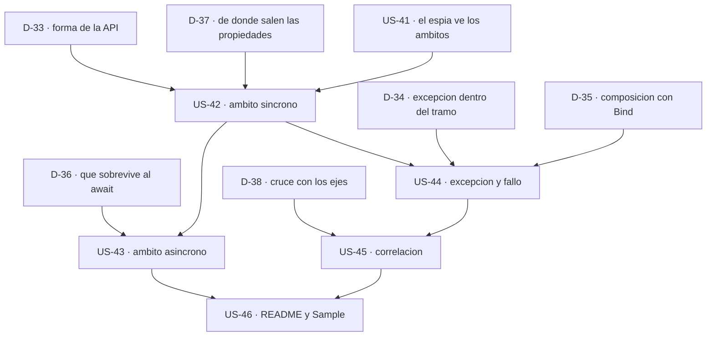

# Épica 9 · Ámbitos de registro: unir las trazas de una misma operación

> **Versión destino** · 2.4.0 (US-41 … US-46)
> **Origen** · [`D-29`](../../2.3.0/Logging/Epica-08-Registro-Estructurado-y-Plantillas.md#5-decisiones-abiertas) opción **(b)** de la [épica 8](../../2.3.0/Logging/Epica-08-Registro-Estructurado-y-Plantillas.md) · hallazgo del [punto 32](../../2.3.0/Logging/Epica-08-Registro-Estructurado-y-Plantillas.md#punto-32--cero-beginscope-no-hay-forma-de-correlacionar)
> **Plan del que se desgaja** · [`README.md`](README.md) de la versión 2.4.0
> **Proyecto** · `src/MoralesLarios.OOFP.Logging`
> **Estado** · ⬜ no iniciada · **6 decisiones abiertas**, todas bloqueantes
> **Esfuerzo** · **XL** (~3,5 jornadas)
> **Riesgo** · 🟠 alto · el ámbito es la primera pieza de la librería con **estado vivo** y con un `IDisposable` que hay que cerrar sí o sí
>
> **Leyenda de esfuerzo:** XS (<2 h) · S (½ jornada) · M (1 jornada) · L (2 jornadas) · XL (3+ jornadas)
> **Leyenda de riesgo:** 🟢 bajo · 🟡 medio · 🟠 alto · 🔴 muy alto (rompe compatibilidad)

---

## Índice

1. [Contexto y problema](#1-contexto-y-problema)
   - [Punto 34 — Las trazas de una misma tubería no comparten contexto](#punto-34--las-trazas-de-una-misma-tubería-no-comparten-contexto)
   - [Punto 35 — Un ámbito es un `IDisposable`, y aquí no hay dónde ponerlo](#punto-35--un-ámbito-es-un-idisposable-y-aquí-no-hay-dónde-ponerlo)
   - [Punto 36 — Las tres preguntas que `D-29` dejó planteadas](#punto-36--las-tres-preguntas-que-d-29-dejó-planteadas)
   - [Punto 37 — El `EventId` tapa el agujero, pero sólo a medias](#punto-37--el-eventid-tapa-el-agujero-pero-sólo-a-medias)
2. [Alcance](#2-alcance)
3. [Historias de usuario](#3-historias-de-usuario)
4. [Orden de ejecución](#4-orden-de-ejecución)
5. [Decisiones abiertas](#5-decisiones-abiertas)
6. [Definición de terminado](#6-definición-de-terminado)
7. [Apéndice · lo que hay que medir antes de decidir](#7-apéndice--lo-que-hay-que-medir-antes-de-decidir)
8. [Ver también](#8-ver-también)

---

## 1. Contexto y problema

La [épica 8](../../2.3.0/Logging/Epica-08-Registro-Estructurado-y-Plantillas.md) cerró el primero de
los dos ceros que quedaban del estándar de `Microsoft.Extensions.Logging`: desde la 2.3.0 el
consumidor puede entregar **plantilla y argumentos**, y los marcadores llegan al *sink* como campos
consultables. Queda el segundo cero, y es el que esta épica ataca:

| Elemento del estándar | 2.1.1 | 2.2.0 | 2.3.0 | Tras esta épica |
|-----------------------|------:|------:|------:|----------------:|
| `ILogger.IsEnabled` | 0 | 7 | 7 | 7 |
| `EventId` | 0 | 123 | > 123 | > 123 |
| `ILogger<TCategory>` | 0 | 21 | 21 | ver [`D-38`](#5-decisiones-abiertas) |
| Plantilla de mensaje con argumentos | 0 | 0 | **✅ 242 firmas** | ✅ |
| **`ILogger.BeginScope`** | **0** | **0** | **0** | **objetivo** |
| `LoggerMessage` (generación de código) | 0 | 0 | 0 | fuera de alcance · [`D-30`](../../2.3.0/Logging/Epica-08-Registro-Estructurado-y-Plantillas.md#5-decisiones-abiertas) (a) |

`D-29` desgajó los ámbitos a esta épica con un argumento concreto: no son una variación de la
plantilla, son **otra cosa**. La plantilla es una decisión de *formato* que se toma y se resuelve en
una sola llamada; el ámbito es una decisión de *ciclo de vida* que abarca **varias** llamadas, tiene
un principio y un final, y hay que garantizar ese final incluso cuando el tramo que envuelve lanza.
Mezclarlo con la épica 8 habría hecho de ella un cajón de sastre.

### Punto 34 — Las trazas de una misma tubería no comparten contexto

Éste es el código que escribe hoy el consumidor, ya con las plantillas de la 2.3.0:

```csharp
origen.Bind(Validar)
      .LogMlResultInformationTemplate(logger, "pedido {PedidoId} validado", id)
      .Bind(Guardar)
      .LogMlResultInformationTemplate(logger, "pedido {PedidoId} guardado", id)
      .LogMlResultErrorIfFailTemplate(logger, MlResultLogErrorFields.DefaultTemplate);
```

Las tres trazas pertenecen a la **misma operación lógica** y nada las une. El consumidor lo paga tres
veces:

1. **Repite el dato de correlación en cada llamada.** El `{PedidoId}` aparece tantas veces como
   trazas haya, y si en un tramo se olvida, ese tramo queda huérfano.
2. **No puede añadir contexto de infraestructura.** El `TenantId`, el `UsuarioId` o el
   `CorrelationId` del extremo HTTP no tienen por dónde entrar en las trazas de la tubería salvo
   escribiéndolos uno a uno en cada plantilla.
3. **No puede reconstruir el recorrido.** En el *sink* no hay forma de preguntar «dame todas las
   trazas de la operación X», que es precisamente la consulta que justifica haber instalado Seq u
   OpenTelemetry.

Lo que debería poder escribir es esto, y no puede:

```csharp
using (logger.BeginScope("{Operacion} de {ClienteId}", "AltaPedido", clienteId))
{
    origen.Bind(Validar)
          .LogMlResultInformationTemplate(logger, "pedido {PedidoId} validado", id)
          .Bind(Guardar);
}
```

> ⚠️ **Matiz importante: el `using` manual YA funciona hoy.** Nada impide al consumidor abrir el
> ámbito él mismo con `logger.BeginScope(...)` y encadenar dentro: la librería no estorba. Lo que no
> existe es una forma **de estilo funcional** de hacerlo, sin salirse de la cadena y sin una
> sentencia de bloque en medio de una expresión. Esto es lo que mide la opción **(c)** de
> [`D-33`](#5-decisiones-abiertas), y es la razón de que esta épica tenga que justificar su propio
> valor antes de escribir una línea.

### Punto 35 — Un ámbito es un `IDisposable`, y aquí no hay dónde ponerlo

`ILogger.BeginScope<TState>(TState state)` devuelve un `IDisposable`. Toda la librería está construida
sobre métodos de extensión **sin estado** que reciben un `MlResult<T>` y devuelven otro `MlResult<T>`:
no hay ningún sitio donde guardar ese `IDisposable` entre dos llamadas de la cadena.

Eso deja dos formas posibles, y son incompatibles entre sí:

```csharp
// Forma A · el ámbito envuelve un TRAMO: la librería lo abre y lo cierra, y el tramo es una lambda
origen.WithLogScope(logger, "{Operacion} de {ClienteId}", ["AltaPedido", clienteId],
                    tramo: r => r.Bind(Validar).Bind(Guardar));

// Forma B · el ámbito se DEVUELVE: el consumidor lo cierra, y la cadena vuelve a ser plana
using var ambito = logger.BeginMlLogScope("{Operacion} de {ClienteId}", "AltaPedido", clienteId);
origen.Bind(Validar).Bind(Guardar);
```

La **A** garantiza el cierre y conserva el estilo de expresión, al precio de una lambda y de un nivel
de anidamiento. La **B** no garantiza nada —si el consumidor se olvida del `using`, el ámbito queda
abierto y contamina todo lo que venga después en ese hilo— pero no cambia la forma de la cadena. Es
[`D-33`](#5-decisiones-abiertas), y es la decisión que bloquea a todas las demás.

### Punto 36 — Las tres preguntas que `D-29` dejó planteadas

`D-29` no desgajó los ámbitos por volumen de trabajo, sino porque plantean **tres preguntas de diseño
propias** que la épica 8 no tenía por qué responder. Están aquí, cada una con su decisión:

| Pregunta de `D-29` | Por qué no es obvia | Decisión |
|--------------------|---------------------|:--------:|
| **¿Qué pasa si el tramo lanza?** | El ámbito tiene que cerrarse de todos modos, así que hace falta un `try/finally`. Pero entonces, ¿la excepción se propaga —y el consumidor pierde la cadena— o se captura y se convierte en un `MlResult` fallido, como hace la familia `Try*` del núcleo? Las dos respuestas son defendibles y producen APIs distintas. | [`D-34`](#5-decisiones-abiertas) |
| **¿Cómo se compone con `Bind`?** | Un ámbito que envuelve `r => r.Bind(A).Bind(B)` es un **combinador**, no un registrador: es la primera pieza de `Logging` que recibe un trozo de tubería como parámetro. Hay que fijar qué pasa si el tramo devuelve un fallo, si se puede anidar un ámbito dentro de otro y qué se registra al entrar y al salir. | [`D-35`](#5-decisiones-abiertas) |
| **¿El ámbito debe sobrevivir al `await`?** | `BeginScope` de `Microsoft.Extensions.Logging` se apoya en `AsyncLocal`, así que **en principio sí** fluye a través del `await`. Pero la librería tiene variantes `Async` que reciben un `Task<MlResult<T>>` ya iniciado: ese `Task` puede haber empezado **antes** de que el ámbito se abriera, y entonces sus trazas internas no lo llevarán. Es un comportamiento sutil que hay que probar y documentar, no suponer. | [`D-36`](#5-decisiones-abiertas) |

### Punto 37 — El `EventId` tapa el agujero, pero sólo a medias

El `README.md` del proyecto dice hoy, y dice bien, que para correlacionar trazas se use el `EventId`
de la familia 7, que existe desde la 2.2.0 y que desde la 2.3.0 se cruza con las plantillas. Es un
consejo honesto, pero conviene no exagerar su alcance:

| | `EventId` | Ámbito |
|-|-----------|--------|
| **Qué identifica** | el **tipo** de suceso (`PedidoCreado`) | la **instancia** de la operación (el pedido 4711 de este usuario) |
| **Cardinalidad** | baja, un catálogo cerrado | alta, una por ejecución |
| **Se propaga a las trazas de dentro** | no: hay que repetirlo en cada llamada | sí: todo lo que se registre dentro lo lleva |
| **Alcanza al código ajeno a la librería** | no | **sí**: también a las trazas que emitan `EF Core` o `HttpClient` dentro del ámbito |

La última fila es la que decide. Con `EventId` se agrupan trazas **del mismo tipo**; con un ámbito se
agrupan las trazas **de la misma ejecución**, incluidas las que no emite esta librería. Son
complementarios, no alternativos, y por eso el consejo del `README.md` se queda corto en cuanto el
consumidor quiere depurar *una* ejecución concreta.

---

## 2. Alcance

**Entra:**

| Asunto | Dónde |
|--------|-------|
| El combinador que abre un ámbito sobre un tramo de tubería | fichero nuevo `MlResultLogScopeExtensions.cs` |
| La semántica de excepción y de fallo dentro del ámbito | el mismo fichero · [`D-34`](#5-decisiones-abiertas) |
| Las variantes `Async`, con la prueba de qué sobrevive al `await` | el mismo fichero · [`D-36`](#5-decisiones-abiertas) |
| La captura de ámbitos en el espía de pruebas | `Support/StructuredLoggerSpy.cs` |
| La documentación de la capacidad y la retirada del aviso «no hay `scopes`» | `README.md` del proyecto · `Sample` |

**No entra:**

| Asunto | Dónde va | Por qué |
|--------|----------|---------|
| `LoggerMessage.Define` y el generador de `[LoggerMessage]` | 3.0.0 | ya descartado en [`D-30`](../../2.3.0/Logging/Epica-08-Registro-Estructurado-y-Plantillas.md#5-decisiones-abiertas) (a): la plantilla la trae el consumidor en ejecución |
| El manejador de cadena interpolada de [`D-26`](../../2.3.0/Logging/Epica-08-Registro-Estructurado-y-Plantillas.md#5-decisiones-abiertas) (c) | 3.0.0 | es una capa **sobre** la familia `…Template`, no sobre los ámbitos |
| Un tipo de opciones `MlLogOptions` | 3.0.0 | cambia el estilo de la API |
| Pasar la `Exception` al `ILogger` | 3.0.0 | es otro hallazgo, independiente del ámbito |

**Naturaleza prevista: aditiva.** Ninguna firma existente se toca. El único cambio de contrato
posible es que el `README.md` deja de decir que no hay ámbitos, y eso se registra como aditivo en el
prompt de migración.

---

## 3. Historias de usuario

> La numeración continúa desde la **US-40**, que fue la última de la épica 8.

### US-41 · Red de seguridad: que el espía vea los ámbitos

**Como** desarrollador de la librería
**quiero** que las pruebas puedan afirmar qué ámbitos se abrieron, con qué propiedades y en qué orden
**para** no tener que creerme que el ámbito funciona.

- **Esfuerzo** · M · **Riesgo** · 🟢 · **Rompe** · no

**Criterios de aceptación**

- [ ] `Support/StructuredLoggerSpy.cs` deja de devolver `NullScope.Instance` en `BeginScope` y pasa a
      registrar cada ámbito: el `state`, sus propiedades si es enumerable, el instante de apertura y
      el de cierre.
- [ ] El espía expone los ámbitos **abiertos en el momento de cada traza**, de modo que se pueda
      afirmar que una traza concreta cayó dentro del ámbito y no fuera.
- [ ] Existe un test que demuestra que el espía detecta un ámbito **sin cerrar**, porque es el fallo
      que la opción (b) de [`D-33`](#5-decisiones-abiertas) haría posible.
- [ ] Los tests que hoy usan el espía siguen en verde: el cambio es aditivo sobre su API de 17
      miembros.

### US-42 · El ámbito mínimo sobre un tramo síncrono

**Como** consumidor que encadena operaciones
**quiero** abrir un ámbito sobre un tramo de la cadena sin salirme del estilo de expresión
**para** que todas las trazas de ese tramo compartan contexto.

- **Esfuerzo** · L · **Riesgo** · 🟠 · **Rompe** · no

**Criterios de aceptación**

- [ ] **Resuelta [`D-33`](#5-decisiones-abiertas)**, que fija la forma de la API, y
      **[`D-37`](#5-decisiones-abiertas)**, que fija de dónde salen las propiedades.
- [ ] Existe la familia nueva en `MlResultLogScopeExtensions.cs`, con documentación XML en cada
      miembro público y `0 CS1591`.
- [ ] El ámbito se cierra **siempre**, verificado con un test que lanza dentro del tramo.
- [ ] El ámbito se abre **antes** de evaluar el tramo y se cierra **después** de la última traza del
      tramo, verificado con el espía de la US-41.
- [ ] Un `logger` nulo no revienta: se evalúa el tramo sin ámbito, igual que hoy un `logger` nulo
      devuelve el `source` intacto.
- [ ] El recuento de firmas públicas del proyecto queda documentado antes y después, continuando la
      tabla de la [§7.1 de la épica 8](../../2.3.0/Logging/Epica-08-Registro-Estructurado-y-Plantillas.md#71--recuento-de-firmas-públicas-por-fichero-us-36).

### US-43 · El ámbito en la tubería asíncrona

**Como** consumidor cuya tubería es `async`
**quiero** saber exactamente qué trazas quedan dentro del ámbito
**para** no depurar a ciegas.

- **Esfuerzo** · L · **Riesgo** · 🟠 · **Rompe** · no

**Criterios de aceptación**

- [ ] **Resuelta [`D-36`](#5-decisiones-abiertas)** · qué se promete respecto al `await`.
- [ ] Existen las variantes `Async` con el sufijo correcto, según el convenio de la
      [épica 4](../../2.2.0/Logging/Epica-04-Nomenclatura-y-Firmas-Publicas.md).
- [ ] Hay un test que demuestra el caso **peligroso**: un `Task<MlResult<T>>` **ya iniciado** que se
      pasa a la sobrecarga `Async`. Se documenta si sus trazas internas caen dentro del ámbito o no,
      con el resultado medido, no supuesto.
- [ ] Hay un test que demuestra que dos tuberías concurrentes **no se contaminan** el ámbito entre
      ellas.
- [ ] El comportamiento respecto al `await` queda escrito en el `README.md` del proyecto, en el
      apartado de particularidades reales del código fuente.

### US-44 · Semántica de la excepción y del fallo dentro del ámbito

**Como** consumidor
**quiero** saber qué le pasa a mi cadena si el tramo envuelto lanza o falla
**para** no descubrirlo en producción.

- **Esfuerzo** · M · **Riesgo** · 🟠 · **Rompe** · no

**Criterios de aceptación**

- [ ] **Resuelta [`D-34`](#5-decisiones-abiertas)** · propagar la excepción o convertirla en fallo, y
      **[`D-35`](#5-decisiones-abiertas)** · qué se registra al entrar y al salir del tramo.
- [ ] El ámbito se cierra en un `finally`, y hay un test que lo prueba con una excepción que
      atraviesa el tramo.
- [ ] Si la decisión es convertir la excepción en `MlResult` fallido, el `MlErrorDetails` resultante
      arrastra la excepción, comprobado con `GetException()`.
- [ ] Un tramo que devuelve un `MlResult` **fallido** no impide el cierre del ámbito ni altera lo que
      se registra respecto al caso válido, salvo lo que `D-35` decida de forma explícita.
- [ ] Se puede **anidar** un ámbito dentro de otro y las propiedades de los dos llegan a la traza,
      verificado con el espía.

### US-45 · Correlación: el identificador y el cruce con los ejes existentes

**Como** consumidor que explota las trazas en un *sink*
**quiero** un identificador de ejecución y poder combinar el ámbito con lo que ya existe
**para** reconstruir el recorrido completo de una operación.

- **Esfuerzo** · M · **Riesgo** · 🟡 · **Rompe** · no

**Criterios de aceptación**

- [ ] **Resuelta [`D-38`](#5-decisiones-abiertas)** · hasta dónde se cruza el ámbito con `EventId`,
      con los seis niveles y con `ILogger<TCategory>`, con el mismo criterio de contención que aplicó
      [`D-28`](../../2.3.0/Logging/Epica-08-Registro-Estructurado-y-Plantillas.md#5-decisiones-abiertas) (b) en la épica 8.
- [ ] Si la decisión aprueba un identificador automático, su nombre de campo es **contrato público**
      y vive junto a los de `MlResultLogErrorFields`, con el mismo aviso de ruptura silenciosa que
      el [punto 54](../../../Copilot/.github/prompts/oofp-upgrade-2.prompt.md) del prompt.
- [ ] La combinatoria **no explota**: se documenta el recuento de firmas que añade cada cruce
      aprobado y se justifica cada uno de los que se descartan.

### US-46 · Documentar los ámbitos de cara al consumidor

**Como** consumidor que abre el `README.md`
**quiero** encontrar los ámbitos explicados con ejemplos y con sus límites
**para** no tener que deducirlos de las firmas.

- **Esfuerzo** · S · **Riesgo** · 🟢 · **Rompe** · no

**Criterios de aceptación**

- [ ] El `README.md` del proyecto tiene una sección nueva para los ámbitos, con su entrada en el
      índice y la tabla de recuentos actualizada.
- [ ] Se **retira** el aviso «No hay `scopes` ni `BeginScope`» del apartado «Lo que NO incluye», y se
      sustituye por el límite real que quede tras esta épica.
- [ ] Se actualiza la tabla de decisión rápida: hoy manda al `EventId` para correlacionar, y debe
      distinguir **tipo de suceso** (`EventId`) de **instancia de ejecución** (ámbito), según el
      [punto 37](#punto-37--el-eventid-tapa-el-agujero-pero-sólo-a-medias).
- [ ] Hay un ejemplo de extremo a extremo con la traza renderizada **y** las propiedades del ámbito
      tal como las ve el *sink*.
- [ ] El `Sample` incorpora un ámbito y sigue ejecutándose con **`EXIT = 0`**.
- [ ] `scripts\check-md-anchors4.ps1` termina con **`rotos = 0`**.
- [ ] **Registro en los 6 sitios** de
      [`oofp-upgrade-2.prompt.md`](../../../Copilot/.github/prompts/oofp-upgrade-2.prompt.md),
      continuando la numeración desde el último punto usado, y en
      [`oofp-upgrade-2.renames.md`](../../../Copilot/.github/prompts/oofp-upgrade-2.renames.md) si
      hubiera renombrados.

---

## 4. Orden de ejecución



**Justificación.**

1. **La US-41 va primera, y sin excepción.** Mientras el espía devuelva `NullScope.Instance` no hay
   forma de escribir una sola afirmación sobre un ámbito. Empezar por el código de producción
   significaría escribirlo sin red, que es justo lo que la
   [épica 1](../../2.2.0/Logging/Epica-01-Red-de-Seguridad.md) vino a evitar.
2. **`D-33` y `D-37` antes que cualquier línea de producción.** De `D-33` depende la **forma** de la
   API y de `D-37` la **firma**. Decidirlas después obligaría a reescribir, o a publicar algo que no
   se puede cambiar.
3. **La US-43 después de la US-42** porque la variante asíncrona es la síncrona más una promesa sobre
   el `await`. No se puede prometer sobre algo que aún no existe.
4. **La US-44 después de la US-42** por la misma razón: la semántica de la excepción se prueba sobre
   el combinador ya construido.
5. **La US-45 al final de lo técnico**, porque cruzar ejes sólo tiene sentido con el eje nuevo
   completo. Es la lección de la US-36 de la épica 8.
6. **La US-46 siempre al final.** El `README.md` documenta lo que existe; escribirlo antes garantiza
   que miente.

> **Puerta de entrada.** Ninguna historia empieza sin la red de la
> [épica 1](../../2.2.0/Logging/Epica-01-Red-de-Seguridad.md): **1.502 tests en verde** tras la
> épica 8, y los dos tests de paridad de `MatrixTests.cs` como detector de asimetrías.

---

## 5. Decisiones abiertas

> La numeración continúa desde `D-32`, que fue la última de la 2.3.0. **Las seis están abiertas** y
> hay que cerrarlas antes de escribir código de producción.

### `D-33` · Forma de la API del ámbito

| Opción | Propuesta | A favor | En contra |
|:------:|-----------|---------|-----------|
| **(a)** | **El ámbito envuelve un tramo**: `origen.WithLogScope(logger, plantilla, propiedades, tramo: r => …)` | el cierre está **garantizado**; se conserva el estilo de expresión; encaja con el `try/finally` | obliga a una lambda y a un nivel de anidamiento; el tramo deja de leerse como una cadena plana |
| **(b)** | **El ámbito se devuelve**: `using var a = logger.BeginMlLogScope(plantilla, propiedades)` | la cadena no cambia de forma; una sola firma | si el consumidor olvida el `using`, el ámbito **se filtra** al resto del hilo; no es funcional, es imperativo |
| **(c)** | **No se añade nada**: se documenta el `using logger.BeginScope(...)` del estándar | coste cero; sin superficie nueva que mantener | no resuelve el punto 34; obliga a salir del estilo de la librería |
| **(d)** | **(a) y (b)**, con la (b) documentada como la vía de escape | cubre los dos estilos | duplica la superficie y hay que explicar cuándo usar cada una |

> **Recomendación.** La **(a)**. Es la única que garantiza el cierre, y el cierre no es un detalle:
> un ámbito filtrado contamina **todas** las trazas posteriores del hilo, incluidas las que no emite
> esta librería. La (c) merece una medición honesta antes de descartarla —ver la
> [§7](#7-apéndice--lo-que-hay-que-medir-antes-de-decidir)—, porque si el `using` manual cubre el 90 %
> de los casos, la superficie nueva no se paga.

### `D-34` · ¿Qué pasa si el tramo lanza?

| Opción | Propuesta |
|:------:|-----------|
| **(a)** | Se cierra el ámbito en un `finally` y **se propaga** la excepción |
| **(b)** | Se cierra el ámbito y la excepción **se convierte** en `MlResult` fallido, como la familia `Try*` del núcleo |
| **(c)** | **(a) por omisión**, y una variante `TryWithLogScope` que hace la (b) |

> **Recomendación.** La **(c)**. La (a) respeta el principio de la librería de no cambiar el flujo de
> excepciones por su cuenta, y es lo que hoy hace el resto de `Logging`: una excepción dentro de un
> `Func` del consumidor **rompe la cadena**, y así está documentado. La (b) es útil, pero cambiar el
> comportamiento por omisión escondería una captura, y el convenio `Try*` existe precisamente para
> que capturar sea **explícito en el nombre**.

### `D-35` · ¿Cómo se compone con `Bind`?

| Opción | Propuesta |
|:------:|-----------|
| **(a)** | El ámbito es **transparente**: no registra nada por sí mismo, sólo añade propiedades a lo que se registre dentro |
| **(b)** | El ámbito registra una traza de **entrada** y otra de **salida**, con el resultado del tramo |
| **(c)** | (a) por omisión, y sobrecargas que hagan la (b) con niveles configurables |

> **Recomendación.** La **(a)**. Es lo que hace `BeginScope` en el estándar, y respeta el patrón
> fundamental de la librería: el log es **transparente** y no decide por el consumidor. La (b)
> duplicaría trazas en una tubería que ya registra lo que quiere registrar.

### `D-36` · ¿El ámbito sobrevive al `await`?

| Opción | Propuesta |
|:------:|-----------|
| **(a)** | Se **promete** que sí, apoyándose en el `AsyncLocal` de `Microsoft.Extensions.Logging`, y se prueba |
| **(b)** | Se promete sólo para los tramos que la librería **inicia** ella misma, y se documenta que un `Task` ya iniciado **puede** quedar fuera |
| **(c)** | No se promete nada y se documenta como comportamiento del proveedor de registro |

> **Recomendación.** La **(b)**. Es la única honesta: el `AsyncLocal` fluye hacia dentro de lo que se
> inicia **dentro** del ámbito, pero las variantes `Async` de esta librería reciben un
> `Task<MlResult<T>>` que el consumidor **ya ha iniciado**, y sus trazas internas pueden haberse
> emitido antes. Hay que medirlo y escribirlo, no suponerlo.

### `D-37` · ¿De dónde salen las propiedades del ámbito?

| Opción | Propuesta | Nota |
|:------:|-----------|------|
| **(a)** | **Plantilla + argumentos**, igual que la familia `…Template` de la 2.3.0 | coherente con lo que el consumidor ya aprendió |
| **(b)** | Un **diccionario** `IEnumerable<KeyValuePair<string, object?>>` | es lo que los *sinks* esperan de verdad; sin ambigüedad de marcadores |
| **(c)** | Las **dos** | superficie doble, pero cubre los dos usos reales |

> **Recomendación.** La **(c)**, con la (a) como forma principal. La plantilla es la que mantiene la
> coherencia con la épica 8 y la que el consumidor va a escribir; el diccionario es el que necesita
> quien compone el contexto en tiempo de ejecución, por ejemplo desde una cabecera HTTP. El coste de
> añadir la (b) es una sobrecarga por firma, no una familia nueva.

### `D-38` · ¿Hasta dónde se cruza el ámbito con los ejes existentes?

| Opción | Propuesta |
|:------:|-----------|
| **(a)** | Sólo la familia genérica: una firma, sin cruzar con nada |
| **(b)** | Genérica **más** `EventId`, con el criterio de [`D-28`](../../2.3.0/Logging/Epica-08-Registro-Estructurado-y-Plantillas.md#5-decisiones-abiertas) (b) |
| **(c)** | Todo: genérica, seis niveles, `EventId` e `ILogger<TCategory>` |
| **(d)** | Un identificador de correlación **automático** si el consumidor no aporta ninguno |

> **Recomendación.** La **(a)** para la 2.4.0, y la (d) a decisión aparte. El ámbito **no es un
> registrador**: no emite traza propia si `D-35` se resuelve con la (a), así que no tiene sentido
> declinarlo por los seis niveles ni darle un `EventId`. La (c) multiplicaría la superficie sin
> ganancia. La (d) es atractiva, pero convierte un nombre de campo en contrato público, con el mismo
> riesgo de ruptura silenciosa que el punto 54 del prompt: merece su propia decisión.

---

## 6. Definición de terminado

Esta épica no se da por cerrada hasta que **todo** lo siguiente es cierto:

- [ ] **Las seis decisiones `D-33` … `D-38` están resueltas** y escritas en este documento, con la
      opción elegida marcada.
- [ ] `dotnet build MoralesLarios.OOFP.sln -c Release --no-incremental` ⇒ **`EXIT = 0`**,
      **0 errores**, **0 `CS1591`**, **0 `CS1572`/`CS1573`/`CS1574`**, **0 `CS0618`** y **sin avisos
      nuevos** sobre la línea base de **236**.
- [ ] `dotnet test MoralesLarios.OOFP.sln -c Release --no-build` ⇒ **`EXIT = 0`**, **0 con error**,
      **0 omitidos**, y el total **por encima** de los 1.502 de la 2.3.0.
- [ ] Los **dos tests de paridad** de `MatrixTests.cs` siguen en verde, actualizados si el cruce de
      `D-38` añade firmas por nivel.
- [ ] Existe el test que demuestra que el ámbito **se cierra** aunque el tramo lance, y el que
      demuestra que dos tuberías concurrentes no se contaminan.
- [ ] El `Sample` se ejecuta con **`EXIT = 0`**.
- [ ] `scripts\check-md-anchors4.ps1` ⇒ **`rotos = 0`**.
- [ ] El `README.md` del proyecto refleja la API **real** y ha retirado el aviso de que no hay
      ámbitos.
- [ ] Todo aditivo relevante está registrado en los **6 sitios** de
      [`oofp-upgrade-2.prompt.md`](../../../Copilot/.github/prompts/oofp-upgrade-2.prompt.md), y los
      renombrados —si hubiera— en
      [`oofp-upgrade-2.renames.md`](../../../Copilot/.github/prompts/oofp-upgrade-2.renames.md).
- [ ] Los commits siguen **Conventional Commits en castellano**, con `!` si rompen, creados con
      `git commit -F` desde un fichero **UTF-8 sin BOM**.
- [ ] **No se publica sin confirmación** del propietario.

---

## 7. Apéndice · lo que hay que medir antes de decidir

La épica 8 cerró `D-26` con una **prueba compilada**, no con una intuición, y esa prueba cambió el
diseño. Aquí hay cuatro mediciones del mismo tipo, y conviene hacerlas **antes** de cerrar las
decisiones:

| # | Medición | Qué decide |
|:-:|----------|------------|
| 1 | Escribir el caso del punto 34 con `using logger.BeginScope(...)` **a mano** y contar qué estorba de verdad | si la opción **(c)** de `D-33` basta, y entonces esta épica se cierra sin código |
| 2 | Comprobar con el espía si un `Task<MlResult<T>>` **ya iniciado** lleva o no las propiedades del ámbito | `D-36`, que es la única pregunta de `D-29` con una respuesta medible |
| 3 | Medir las asignaciones por llamada con el nivel **apagado**, igual que hizo la épica 6 (línea base **240,0 B**) | si el ámbito hay que abrirlo también cuando nadie escucha |
| 4 | Contar cuántas firmas añadiría cada cruce de `D-38` | si la combinatoria se paga o se contiene, como ya decidió `D-28` (b) |

**Mediciones pendientes** (se rellenan al cerrar la épica):

| Métrica | Línea base 2.3.0 | Tras la épica |
|---------|-----------------:|--------------:|
| Firmas públicas del proyecto | 640 | *pendiente* |
| Avisos del build en Release | 236 | *pendiente* |
| Tests | 1.502 | *pendiente* |
| `BeginScope` en el proyecto | **0** | *pendiente* |
| Asignaciones por llamada, nivel apagado | 240,0 B | *pendiente* |

---

## 8. Ver también

- [`README.md`](README.md) · plan de la versión 2.4.0
- [`Epica-08-Registro-Estructurado-y-Plantillas.md`](../../2.3.0/Logging/Epica-08-Registro-Estructurado-y-Plantillas.md) · la épica que desgajó ésta, en su `D-29`
- [`Epica-01-Red-de-Seguridad.md`](../../2.2.0/Logging/Epica-01-Red-de-Seguridad.md) · la red de tests que esta épica presupone
- [`Epica-04-Nomenclatura-y-Firmas-Publicas.md`](../../2.2.0/Logging/Epica-04-Nomenclatura-y-Firmas-Publicas.md) · el convenio `Async`
- [`Epica-06-Rendimiento-y-Estandar-de-Logging.md`](../../2.2.0/Logging/Epica-06-Rendimiento-y-Estandar-de-Logging.md) · `IsEnabled`, `EventId` e `ILogger<TCategory>`
- [`README.md` del proyecto](../../../../MoralesLarios.OOFP.Logging/README.md) · la API tal como está hoy
- [`oofp-upgrade-2.prompt.md`](../../../Copilot/.github/prompts/oofp-upgrade-2.prompt.md) · prompt de migración
