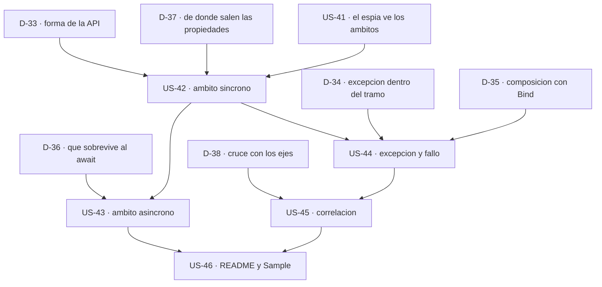

# Épica 9 · Ámbitos de registro: unir las trazas de una misma operación

> **Versión destino** · 2.4.0 (US-41 … US-46)
> **Origen** · [`D-29`](../../2.3.0/Logging/Epica-08-Registro-Estructurado-y-Plantillas.md#5-decisiones-abiertas) opción **(b)** de la [épica 8](../../2.3.0/Logging/Epica-08-Registro-Estructurado-y-Plantillas.md) · hallazgo del [punto 32](../../2.3.0/Logging/Epica-08-Registro-Estructurado-y-Plantillas.md#punto-32--cero-beginscope-no-hay-forma-de-correlacionar)
> **Plan del que se desgaja** · [`README.md`](README.md) de la versión 2.4.0
> **Proyecto** · `src/MoralesLarios.OOFP.Logging`
> **Estado** · ⬜ no iniciada · **6 decisiones abiertas**, todas bloqueantes
> **Esfuerzo** · **XL** (~3,5 jornadas)
> **Riesgo** · 🟠 alto · el ámbito es la primera pieza de la librería con **estado vivo** y con un `IDisposable` que hay que cerrar sí o sí
>
> **Leyenda de esfuerzo:** XS (<2 h) · S (½ jornada) · M (1 jornada) · L (2 jornadas) · XL (3+ jornadas)
> **Leyenda de riesgo:** 🟢 bajo · 🟡 medio · 🟠 alto · 🔴 muy alto (rompe compatibilidad)

---

## Índice

1. [Contexto y problema](#1-contexto-y-problema)
   - [Punto 34 — Las trazas de una misma tubería no comparten contexto](#punto-34--las-trazas-de-una-misma-tubería-no-comparten-contexto)
   - [Punto 35 — Un ámbito es un `IDisposable`, y aquí no hay dónde ponerlo](#punto-35--un-ámbito-es-un-idisposable-y-aquí-no-hay-dónde-ponerlo)
   - [Punto 36 — Las tres preguntas que `D-29` dejó planteadas](#punto-36--las-tres-preguntas-que-d-29-dejó-planteadas)
   - [Punto 37 — El `EventId` tapa el agujero, pero sólo a medias](#punto-37--el-eventid-tapa-el-agujero-pero-sólo-a-medias)
2. [Alcance](#2-alcance)
3. [Historias de usuario](#3-historias-de-usuario)
4. [Orden de ejecución](#4-orden-de-ejecución)
5. [Decisiones abiertas](#5-decisiones-abiertas)
6. [Definición de terminado](#6-definición-de-terminado)
7. [Apéndice · lo que hay que medir antes de decidir](#7-apéndice--lo-que-hay-que-medir-antes-de-decidir)
8. [Ver también](#8-ver-también)

---

## 1. Contexto y problema

La [épica 8](../../2.3.0/Logging/Epica-08-Registro-Estructurado-y-Plantillas.md) cerró el primero de
los dos ceros que quedaban del estándar de `Microsoft.Extensions.Logging`: desde la 2.3.0 el
consumidor puede entregar **plantilla y argumentos**, y los marcadores llegan al *sink* como campos
consultables. Queda el segundo cero, y es el que esta épica ataca:

| Elemento del estándar | 2.1.1 | 2.2.0 | 2.3.0 | Tras esta épica |
|-----------------------|------:|------:|------:|----------------:|
| `ILogger.IsEnabled` | 0 | 7 | 7 | 7 |
| `EventId` | 0 | 123 | > 123 | > 123 |
| `ILogger<TCategory>` | 0 | 21 | 21 | ver [`D-38`](#5-decisiones-abiertas) |
| Plantilla de mensaje con argumentos | 0 | 0 | **✅ 242 firmas** | ✅ |
| **`ILogger.BeginScope`** | **0** | **0** | **0** | **objetivo** |
| `LoggerMessage` (generación de código) | 0 | 0 | 0 | fuera de alcance · [`D-30`](../../2.3.0/Logging/Epica-08-Registro-Estructurado-y-Plantillas.md#5-decisiones-abiertas) (a) |

`D-29` desgajó los ámbitos a esta épica con un argumento concreto: no son una variación de la
plantilla, son **otra cosa**. La plantilla es una decisión de *formato* que se toma y se resuelve en
una sola llamada; el ámbito es una decisión de *ciclo de vida* que abarca **varias** llamadas, tiene
un principio y un final, y hay que garantizar ese final incluso cuando el tramo que envuelve lanza.
Mezclarlo con la épica 8 habría hecho de ella un cajón de sastre.

### Punto 34 — Las trazas de una misma tubería no comparten contexto

Éste es el código que escribe hoy el consumidor, ya con las plantillas de la 2.3.0:

```csharp
origen.Bind(Validar)
      .LogMlResultInformationTemplate(logger, "pedido {PedidoId} validado", id)
      .Bind(Guardar)
      .LogMlResultInformationTemplate(logger, "pedido {PedidoId} guardado", id)
      .LogMlResultErrorIfFailTemplate(logger, MlResultLogErrorFields.DefaultTemplate);
```

Las tres trazas pertenecen a la **misma operación lógica** y nada las une. El consumidor lo paga tres
veces:

1. **Repite el dato de correlación en cada llamada.** El `{PedidoId}` aparece tantas veces como
   trazas haya, y si en un tramo se olvida, ese tramo queda huérfano.
2. **No puede añadir contexto de infraestructura.** El `TenantId`, el `UsuarioId` o el
   `CorrelationId` del extremo HTTP no tienen por dónde entrar en las trazas de la tubería salvo
   escribiéndolos uno a uno en cada plantilla.
3. **No puede reconstruir el recorrido.** En el *sink* no hay forma de preguntar «dame todas las
   trazas de la operación X», que es precisamente la consulta que justifica haber instalado Seq u
   OpenTelemetry.

Lo que debería poder escribir es esto, y no puede:

```csharp
using (logger.BeginScope("{Operacion} de {ClienteId}", "AltaPedido", clienteId))
{
    origen.Bind(Validar)
          .LogMlResultInformationTemplate(logger, "pedido {PedidoId} validado", id)
          .Bind(Guardar);
}
```

> ⚠️ **Matiz importante: el `using` manual YA funciona hoy.** Nada impide al consumidor abrir el
> ámbito él mismo con `logger.BeginScope(...)` y encadenar dentro: la librería no estorba. Lo que no
> existe es una forma **de estilo funcional** de hacerlo, sin salirse de la cadena y sin una
> sentencia de bloque en medio de una expresión. Esto es lo que mide la opción **(c)** de
> [`D-33`](#5-decisiones-abiertas), y es la razón de que esta épica tenga que justificar su propio
> valor antes de escribir una línea.

### Punto 35 — Un ámbito es un `IDisposable`, y aquí no hay dónde ponerlo

`ILogger.BeginScope<TState>(TState state)` devuelve un `IDisposable`. Toda la librería está construida
sobre métodos de extensión **sin estado** que reciben un `MlResult<T>` y devuelven otro `MlResult<T>`:
no hay ningún sitio donde guardar ese `IDisposable` entre dos llamadas de la cadena.

Eso deja dos formas posibles, y son incompatibles entre sí:

```csharp
// Forma A · el ámbito envuelve un TRAMO: la librería lo abre y lo cierra, y el tramo es una lambda
origen.WithLogScope(logger, "{Operacion} de {ClienteId}", ["AltaPedido", clienteId],
                    tramo: r => r.Bind(Validar).Bind(Guardar));

// Forma B · el ámbito se DEVUELVE: el consumidor lo cierra, y la cadena vuelve a ser plana
using var ambito = logger.BeginMlLogScope("{Operacion} de {ClienteId}", "AltaPedido", clienteId);
origen.Bind(Validar).Bind(Guardar);
```

La **A** garantiza el cierre y conserva el estilo de expresión, al precio de una lambda y de un nivel
de anidamiento. La **B** no garantiza nada —si el consumidor se olvida del `using`, el ámbito queda
abierto y contamina todo lo que venga después en ese hilo— pero no cambia la forma de la cadena. Es
[`D-33`](#5-decisiones-abiertas), y es la decisión que bloquea a todas las demás.

### Punto 36 — Las tres preguntas que `D-29` dejó planteadas

`D-29` no desgajó los ámbitos por volumen de trabajo, sino porque plantean **tres preguntas de diseño
propias** que la épica 8 no tenía por qué responder. Están aquí, cada una con su decisión:

| Pregunta de `D-29` | Por qué no es obvia | Decisión |
|--------------------|---------------------|:--------:|
| **¿Qué pasa si el tramo lanza?** | El ámbito tiene que cerrarse de todos modos, así que hace falta un `try/finally`. Pero entonces, ¿la excepción se propaga —y el consumidor pierde la cadena— o se captura y se convierte en un `MlResult` fallido, como hace la familia `Try*` del núcleo? Las dos respuestas son defendibles y producen APIs distintas. | [`D-34`](#5-decisiones-abiertas) |
| **¿Cómo se compone con `Bind`?** | Un ámbito que envuelve `r => r.Bind(A).Bind(B)` es un **combinador**, no un registrador: es la primera pieza de `Logging` que recibe un trozo de tubería como parámetro. Hay que fijar qué pasa si el tramo devuelve un fallo, si se puede anidar un ámbito dentro de otro y qué se registra al entrar y al salir. | [`D-35`](#5-decisiones-abiertas) |
| **¿El ámbito debe sobrevivir al `await`?** | `BeginScope` de `Microsoft.Extensions.Logging` se apoya en `AsyncLocal`, así que **en principio sí** fluye a través del `await`. Pero la librería tiene variantes `Async` que reciben un `Task<MlResult<T>>` ya iniciado: ese `Task` puede haber empezado **antes** de que el ámbito se abriera, y entonces sus trazas internas no lo llevarán. Es un comportamiento sutil que hay que probar y documentar, no suponer. | [`D-36`](#5-decisiones-abiertas) |

### Punto 37 — El `EventId` tapa el agujero, pero sólo a medias

El `README.md` del proyecto dice hoy, y dice bien, que para correlacionar trazas se use el `EventId`
de la familia 7, que existe desde la 2.2.0 y que desde la 2.3.0 se cruza con las plantillas. Es un
consejo honesto, pero conviene no exagerar su alcance:

| | `EventId` | Ámbito |
|-|-----------|--------|
| **Qué identifica** | el **tipo** de suceso (`PedidoCreado`) | la **instancia** de la operación (el pedido 4711 de este usuario) |
| **Cardinalidad** | baja, un catálogo cerrado | alta, una por ejecución |
| **Se propaga a las trazas de dentro** | no: hay que repetirlo en cada llamada | sí: todo lo que se registre dentro lo lleva |
| **Alcanza al código ajeno a la librería** | no | **sí**: también a las trazas que emitan `EF Core` o `HttpClient` dentro del ámbito |

La última fila es la que decide. Con `EventId` se agrupan trazas **del mismo tipo**; con un ámbito se
agrupan las trazas **de la misma ejecución**, incluidas las que no emite esta librería. Son
complementarios, no alternativos, y por eso el consejo del `README.md` se queda corto en cuanto el
consumidor quiere depurar *una* ejecución concreta.

---

## 2. Alcance

**Entra:**

| Asunto | Dónde |
|--------|-------|
| El combinador que abre un ámbito sobre un tramo de tubería | fichero nuevo `MlResultLogScopeExtensions.cs` |
| La semántica de excepción y de fallo dentro del ámbito | el mismo fichero · [`D-34`](#5-decisiones-abiertas) |
| Las variantes `Async`, con la prueba de qué sobrevive al `await` | el mismo fichero · [`D-36`](#5-decisiones-abiertas) |
| La captura de ámbitos en el espía de pruebas | `Support/StructuredLoggerSpy.cs` |
| La documentación de la capacidad y la retirada del aviso «no hay `scopes`» | `README.md` del proyecto · `Sample` |

**No entra:**

| Asunto | Dónde va | Por qué |
|--------|----------|---------|
| `LoggerMessage.Define` y el generador de `[LoggerMessage]` | 3.0.0 | ya descartado en [`D-30`](../../2.3.0/Logging/Epica-08-Registro-Estructurado-y-Plantillas.md#5-decisiones-abiertas) (a): la plantilla la trae el consumidor en ejecución |
| El manejador de cadena interpolada de [`D-26`](../../2.3.0/Logging/Epica-08-Registro-Estructurado-y-Plantillas.md#5-decisiones-abiertas) (c) | 3.0.0 | es una capa **sobre** la familia `…Template`, no sobre los ámbitos |
| Un tipo de opciones `MlLogOptions` | 3.0.0 | cambia el estilo de la API |
| Pasar la `Exception` al `ILogger` | 3.0.0 | es otro hallazgo, independiente del ámbito |

**Naturaleza prevista: aditiva.** Ninguna firma existente se toca. El único cambio de contrato
posible es que el `README.md` deja de decir que no hay ámbitos, y eso se registra como aditivo en el
prompt de migración.

---

## 3. Historias de usuario

> La numeración continúa desde la **US-40**, que fue la última de la épica 8.

### US-41 · Red de seguridad: que el espía vea los ámbitos

**Como** desarrollador de la librería
**quiero** que las pruebas puedan afirmar qué ámbitos se abrieron, con qué propiedades y en qué orden
**para** no tener que creerme que el ámbito funciona.

- **Esfuerzo** · M · **Riesgo** · 🟢 · **Rompe** · no

**Criterios de aceptación**

- [x] `Support/StructuredLoggerSpy.cs` deja de devolver `NullScope.Instance` en `BeginScope` y pasa a
      registrar cada ámbito: el `state`, sus propiedades si es enumerable, el instante de apertura y
      el de cierre.
- [x] El espía expone los ámbitos **abiertos en el momento de cada traza**, de modo que se pueda
      afirmar que una traza concreta cayó dentro del ámbito y no fuera.
- [x] Existe un test que demuestra que el espía detecta un ámbito **sin cerrar**, porque es el fallo
      que la opción (b) de [`D-33`](#5-decisiones-abiertas) haría posible.
- [x] Los tests que hoy usan el espía siguen en verde: el cambio es aditivo sobre su API de 17
      miembros.

> ✅ **Hecha.** El tipo nuevo `Support/LoggerScopeRecord.cs` conserva de cada ámbito el `state`, sus
> propiedades, el `OriginalFormat`, la profundidad, el instante de apertura y de cierre y el recuento
> de llamadas a `Dispose`. `StructuredEntry` gana `Scopes`, `IsInsideScope`, `HasScopeProperty(n)` y
> `ScopeProperty(n)` —con el ámbito **más interno** ganando en caso de nombre repetido—, y el espía
> gana `Scopes`, `LastScope`, `LeakedScopes`, `ActiveScopeCount` y una sobrecarga
> `BeginScope(plantilla, args)`. La pila de ámbitos activos es un `ImmutableStack` en un
> `AsyncLocal`, para que dos tuberías concurrentes no se contaminen.
>
> `StructuredLoggerSpyScopeTests.cs` añade **17 tests**, que incluyen el del ámbito filtrado, el del
> `Dispose` repetido y las **mediciones 1 y 2** de la [§7](#7-apéndice--lo-que-hay-que-medir-antes-de-decidir).
> Totales: build `EXIT = 0`, 0 errores, **236 avisos** (sin avisos nuevos), `CS1591 = 0`,
> `CS0618 = 0`; tests `EXIT = 0`, **1.527** totales (desde 1.510), 0 con error, 0 omitidos.

### US-42 · El ámbito mínimo sobre un tramo síncrono

**Como** consumidor que encadena operaciones
**quiero** abrir un ámbito sobre un tramo de la cadena sin salirme del estilo de expresión
**para** que todas las trazas de ese tramo compartan contexto.

- **Esfuerzo** · L · **Riesgo** · 🟠 · **Rompe** · no

**Criterios de aceptación**

- [x] **Resuelta [`D-33`](#5-decisiones-abiertas)**, que fija la forma de la API, y
      **[`D-37`](#5-decisiones-abiertas)**, que fija de dónde salen las propiedades.
- [x] Existe la familia nueva en `MlResultLogScopeExtensions.cs`, con documentación XML en cada
      miembro público y `0 CS1591`.
- [x] El ámbito se cierra **siempre**, verificado con un test que lanza dentro del tramo.
- [x] El ámbito se abre **antes** de evaluar el tramo y se cierra **después** de la última traza del
      tramo, verificado con el espía de la US-41.
- [x] Un `logger` nulo no revienta: se evalúa el tramo sin ámbito, igual que hoy un `logger` nulo
      devuelve el `source` intacto.
- [x] El recuento de firmas públicas del proyecto queda documentado antes y después, continuando la
      tabla de la [§7.1 de la épica 8](../../2.3.0/Logging/Epica-08-Registro-Estructurado-y-Plantillas.md#71--recuento-de-firmas-públicas-por-fichero-us-36).

> ✅ **Hecha.** `MlResultLogScopeExtensions.cs` entrega las **dos** firmas síncronas de
> [`D-37`](#5-decisiones-abiertas): `WithLogScope(logger, scopeTemplate, scopeArgs, section)`, con la
> plantilla anotada con `[StringSyntax("MessageTemplate")]`, y
> `WithLogScope(logger, scopeProperties, section)`, que pasa la secuencia de pares **tal cual** a
> `BeginScope`, sin copiarla ni reordenarla. Las dos delegan en un núcleo privado `RunInScope`, que
> evalúa el tramo dentro de un `try` y cierra el ámbito en el `finally`, de modo que la excepción se
> **propaga** intacta tal y como fija [`D-34`](#5-decisiones-abiertas) para esta historia; el
> `TryWithLogScope` que la convierte en fallo es de la US-44. El ámbito es **transparente** por
> [`D-35`](#5-decisiones-abiertas): no emite ninguna traza propia, así que un ámbito sobre un tramo
> que no registra nada deja el espía vacío. Y no se cruza con los seis niveles, ni con `EventId`, ni
> con `ILogger<TCategory>`, por [`D-38`](#5-decisiones-abiertas).
>
> Las guardas viven en **cada sobrecarga pública**, no en el núcleo: un `section` nulo devuelve un
> resultado fallido con `NullSectionMessage`, y un `logger` o una plantilla nulos evalúan el tramo
> **sin abrir ámbito**, devolviendo lo que devuelva el tramo. Ponerlas en el borde, y no dentro del
> núcleo compartido, es lo que permite que el análisis de nulabilidad estreche los tipos y que la
> llamada a `BeginScope` no arrastre avisos nuevos.
>
> `MlResultLogScopeExtensionsTests.cs` añade **20 tests** repartidos en seis regiones: forma de la API
> por plantilla, forma de la API por diccionario, cierre garantizado —incluido el tramo que lanza—,
> orden de apertura y de cierre, transparencia y guardas de nulos.
>
> De paso se corrigió el espía de la US-41: su `BeginScope` solo reconocía las propiedades cuando el
> `state` era una `IReadOnlyList<KeyValuePair<string, object?>>`, con lo que un `Dictionary` pasado
> por la sobrecarga de diccionario quedaba **invisible** para `Property(n)` y para `ScopeProperty(n)`.
> Ahora acepta **cualquier** `IEnumerable` de pares y la materializa, que es lo que hacen los
> proveedores reales.
>
> Totales: build `EXIT = 0`, 0 errores, **236 avisos** (sin avisos nuevos), `CS1591 = 0`,
> `CS0618 = 0`; tests `EXIT = 0`, **1.547** totales (desde 1.527), 0 con error, 0 omitidos. Firmas
> públicas del proyecto: **641 → 643** (ver [§7.2](#72--recuento-de-firmas-públicas-tras-la-us-42)).

### US-43 · El ámbito en la tubería asíncrona

**Como** consumidor cuya tubería es `async`
**quiero** saber exactamente qué trazas quedan dentro del ámbito
**para** no depurar a ciegas.

- **Esfuerzo** · L · **Riesgo** · 🟠 · **Rompe** · no

**Criterios de aceptación**

- [x] **Resuelta [`D-36`](#5-decisiones-abiertas)** · qué se promete respecto al `await`.
- [x] Existen las variantes `Async` con el sufijo correcto, según el convenio de la
      [épica 4](../../2.2.0/Logging/Epica-04-Nomenclatura-y-Firmas-Publicas.md).
- [x] Hay un test que demuestra el caso **peligroso**: un `Task<MlResult<T>>` **ya iniciado** que se
      pasa a la sobrecarga `Async`. Se documenta si sus trazas internas caen dentro del ámbito o no,
      con el resultado medido, no supuesto.
- [x] Hay un test que demuestra que dos tuberías concurrentes **no se contaminan** el ámbito entre
      ellas.
- [x] El comportamiento respecto al `await` queda escrito en el `README.md` del proyecto, en el
      apartado de particularidades reales del código fuente.

> ✅ **Hecha.** `MlResultLogScopeExtensions.cs` pasa a ser `partial` y `MlResultLogScopeExtensions.Async.cs`
> añade las **seis** firmas `Async` que cierran la fila aceptada de [`D-38`](#5-decisiones-abiertas):
> tres por plantilla y tres por diccionario, con las tres formas del convenio de la
> [épica 4](../../2.2.0/Logging/Epica-04-Nomenclatura-y-Firmas-Publicas.md) —receptor síncrono con
> tramo asíncrono, receptor asíncrono con tramo asíncrono y receptor asíncrono con tramo síncrono—.
> Comparten el núcleo privado `RunInScopeAsync`, que hace `await sectionAsync(source)` dentro de un
> `try` y cierra el ámbito en el `finally`, de modo que el ámbito **sobrevive a los `await` internos**
> del tramo y se cierra una sola vez.
>
> **La promesa del `await`, medida y no supuesta** · resuelve [`D-36`](#5-decisiones-abiertas) por la
> opción **(b)**. Cuando el receptor es una `Task<MlResult<T>>`, esa tarea se **espera antes** de abrir
> el ámbito, porque hace falta su valor para invocar el tramo. Consecuencia: **las trazas que emita la
> tarea de origen quedan FUERA del ámbito**. Los tests lo afirman sobre el espía de la US-41
> (`IsInsideScope == false` y `Scopes` vacío para la traza del origen, frente a
> `ScopeProperty("PedidoId") == 17` para la del tramo), y queda escrito en la **particularidad 8** del
> [`README.md`](../../../../MoralesLarios.OOFP.Logging/README.md) del proyecto, con el patrón correcto
> para meter la carga dentro del ámbito: arrancarla **desde** el tramo, no antes.
>
> **Dentro** del tramo, en cambio, el ámbito sí viaja con la continuación: un test registra después de
> un `await Task.Yield()` y la traza sigue viendo las propiedades. Y **dos tuberías concurrentes no se
> contaminan**: el test abre dos tuberías con `Task.Run`, las sincroniza con dos
> `TaskCompletionSource` para forzar el solape real y comprueba que cada traza ve **exactamente un**
> ámbito, el suyo, con su propio `Nombre`; los dos ámbitos quedan registrados y ninguno se filtra.
>
> `MlResultLogScopeExtensionsAsyncTests.cs` añade **21 tests** en siete regiones: forma de la API por
> plantilla, forma por diccionario, cobertura de la continuación del tramo, la promesa del `await` con
> la tarea ya iniciada, concurrencia y guardas de nulos. El espía **no** afirma `ActiveScopeCount` en
> esta batería, y está explicado en el `<remarks>` de la clase: su `AsyncLocal` se escribe en la
> continuación, que no propaga de vuelta al contexto del test; las afirmaciones de cierre se hacen con
> `LeakedScopes`, `IsClosed` y `DisposeCallCount`, que sí son fiables.
>
> Totales: build `EXIT = 0`, 0 errores, **236 avisos** (sin avisos nuevos), `CS1591 = 0`,
> `CS0618 = 0`; tests `EXIT = 0`, **1.568** totales (desde 1.547), 0 con error, 0 omitidos. Firmas
> públicas del proyecto: **643 → 649** (ver [§7.3](#73--recuento-de-firmas-públicas-tras-la-us-43)).
> El registro en el prompt de migración se hace de una vez para toda la familia de ámbitos en la
> **US-46**; esta historia es puramente aditiva y no rompe nada.

### US-44 · Semántica de la excepción y del fallo dentro del ámbito

**Como** consumidor
**quiero** saber qué le pasa a mi cadena si el tramo envuelto lanza o falla
**para** no descubrirlo en producción.

- **Esfuerzo** · M · **Riesgo** · 🟠 · **Rompe** · no

**Criterios de aceptación**

- [x] **Resuelta [`D-34`](#5-decisiones-abiertas)** · propagar la excepción o convertirla en fallo, y
      **[`D-35`](#5-decisiones-abiertas)** · qué se registra al entrar y al salir del tramo.
- [x] El ámbito se cierra en un `finally`, y hay un test que lo prueba con una excepción que
      atraviesa el tramo.
- [x] Si la decisión es convertir la excepción en `MlResult` fallido, el `MlErrorDetails` resultante
      arrastra la excepción, comprobado con `GetException()`.
- [x] Un tramo que devuelve un `MlResult` **fallido** no impide el cierre del ámbito ni altera lo que
      se registra respecto al caso válido, salvo lo que `D-35` decida de forma explícita.
- [x] Se puede **anidar** un ámbito dentro de otro y las propiedades de los dos llegan a la traza,
      verificado con el espía.

> ✅ **Hecha.** `D-34` se cierra con la opción **(c)** y `D-35` con la **(a)**, y las dos quedan
> **aplicadas en código**, no sólo decididas.
>
> La parte de `D-34` que ya existía es la de por omisión: `WithLogScope` cierra el ámbito en un
> `finally` y **propaga** la excepción, y eso lo afirman dos tests de la US-42 que esta historia
> **reutiliza en vez de duplicar** —`WithLogScope_TramoQueLanza_CierraElAmbitoYPropagaLaExcepcion` y
> `WithLogScope_ConDiccionario_TramoQueLanza_CierraElAmbito`—, igual que el anidamiento del quinto
> criterio lo afirma `WithLogScope_Anidado_CadaTrazaVeLosDosAmbitos`.
>
> La parte nueva es la variante que **captura**: `TryWithLogScope` y `TryWithLogScopeAsync`, en
> `MlResultLogScopeExtensions.Try.cs` y `MlResultLogScopeExtensions.TryAsync.cs`. Convierten la
> excepción del tramo en un `MlResult` fallido cuyo `MlErrorDetails` **arrastra la excepción
> original**, recuperable con `GetException()`; el test
> `TryWithLogScope_TramoQueLanza_ElFalloArrastraLaExcepcionOriginal` lo comprueba con `BeSameAs`, es
> decir, la **misma instancia**, no una copia ni una envoltura. El mensaje por omisión es el del
> núcleo —`EnsureFpMessages.DefaultExceptionError`, el mismo que usa la familia `Try*` de `MlResult`—
> y un parámetro opcional `errorMessageBuilder` permite sustituirlo sin perder la excepción.
>
> La transparencia de `D-35` **(a)** se mantiene intacta en la variante que captura: ni al entrar ni al
> salir se emite traza propia, ni siquiera cuando el tramo lanza, y eso lo fijan dos tests,
> `TryWithLogScope_TramoQueLanza_NoEmiteNingunaTraza` y
> `TryWithLogScope_TramoQueDevuelveFallo_CierraElAmbitoYRegistraLoMismoQueElCasoValido`, el segundo
> comparando dos espías para exigir el mismo recuento de ámbitos, el mismo recuento de trazas y el
> mismo `OriginalFormat` en el caso válido y en el fallido. Y hay una frontera que conviene tener
> escrita: **un `MlResult` fallido no es una excepción**, así que `TryWithLogScope` lo devuelve **tal
> cual**, sin tocarlo y sin añadirle metadatos.
>
> La asimetría del receptor asíncrono queda también medida y escrita: la tarea de origen se espera
> **antes** de abrir el ámbito y, por tanto, **fuera** del `try`, de modo que su excepción **propaga**
> en vez de convertirse en fallo. Es consecuencia directa de [`D-36`](#5-decisiones-abiertas) **(b)**,
> está en el `<remarks>` de las tres sobrecargas con receptor `Task<MlResult<T>>` y lo fija el test
> `TryWithLogScopeAsync_ReceptorAsincronoQueLanza_PropagaLaExcepcionYNoAbreAmbito`, que además
> comprueba que en ese caso **no se abre ningún ámbito**.
>
> Dos baterías nuevas, **35 tests** en total: `MlResultLogScopeExtensionsTryTests.cs` aporta 20 en seis
> regiones —conversión por plantilla, conversión por diccionario, el tramo correcto, el tramo fallido,
> el anidamiento y las guardas de nulos— y `MlResultLogScopeExtensionsTryAsyncTests.cs` aporta 15 en
> ocho, cubriendo los tres cruces receptor/tramo del convenio de la épica 4 por las dos fuentes de
> propiedades, la asimetría del origen y los nulos. Igual que en la US-43, el cierre en las pruebas
> asíncronas se afirma con `LeakedScopes`, `IsClosed` y `DisposeCallCount`, nunca con
> `ActiveScopeCount`, y el motivo está en el `<remarks>` de la clase.
>
> Totales: build `EXIT = 0`, 0 errores, **236 avisos** (sin avisos nuevos), `CS1591 = 0`,
> `CS0618 = 0`; tests `EXIT = 0`, **1.603** totales (desde 1.568), 0 con error, 0 omitidos. Firmas
> públicas del proyecto: **649 → 657** (ver [§7.4](#74--recuento-de-firmas-públicas-tras-la-us-44),
> donde se justifica por qué estas ocho **no** salen del presupuesto cerrado de `D-38`). El registro en
> el prompt de migración se hace de una vez para toda la familia de ámbitos en la **US-46**; esta
> historia es puramente aditiva y no rompe nada.

### US-45 · Correlación: el identificador y el cruce con los ejes existentes

**Como** consumidor que explota las trazas en un *sink*
**quiero** un identificador de ejecución y poder combinar el ámbito con lo que ya existe
**para** reconstruir el recorrido completo de una operación.

- **Esfuerzo** · M · **Riesgo** · 🟡 · **Rompe** · no

**Criterios de aceptación**

- [x] **Resuelta [`D-38`](#5-decisiones-abiertas)** · hasta dónde se cruza el ámbito con `EventId`,
      con los seis niveles y con `ILogger<TCategory>`, con el mismo criterio de contención que aplicó
      [`D-28`](../../2.3.0/Logging/Epica-08-Registro-Estructurado-y-Plantillas.md#5-decisiones-abiertas) (b) en la épica 8.
- [x] Si la decisión aprueba un identificador automático, su nombre de campo es **contrato público**
      y vive junto a los de `MlResultLogErrorFields`, con el mismo aviso de ruptura silenciosa que
      el [punto 54](../../../Copilot/.github/prompts/oofp-upgrade-2.prompt.md) del prompt.
- [x] La combinatoria **no explota**: se documenta el recuento de firmas que añade cada cruce
      aprobado y se justifica cada uno de los que se descartan.

> ✅ **Hecha.** `D-38` queda cerrada con la **(a)**: el ámbito **no se cruza con ningún eje**. El
> detalle del recuento, de los tres cruces descartados y de la **medición 3** del apéndice está en la
> [§7.5](#75--qué-se-cruza-con-el-ámbito-y-qué-cuesta-abrirlo-us-45).
>
> El segundo criterio se cumple **en vacío**, y conviene dejar escrito por qué: la opción **(d)** de
> `D-38` —el identificador de correlación generado por la librería— se **aplaza a la 3.0.0**, así que
> esta historia **no añade ningún nombre de campo público** y `MlResultLogErrorFields` **no cambia**.
> El consumidor que quiera correlación la aporta hoy él mismo con una propiedad del ámbito, que es
> justo lo que habilita [`D-37`](#5-decisiones-abiertas).
>
> La historia no añade **ninguna** firma pública: el recuento se queda en **657**, el mismo que dejó
> la US-44. Lo único que aporta en código es el arnés de medición, en
> `MlResultLogScopeExtensionsAsignacionesTests.cs`.

### US-46 · Documentar los ámbitos de cara al consumidor

**Como** consumidor que abre el `README.md`
**quiero** encontrar los ámbitos explicados con ejemplos y con sus límites
**para** no tener que deducirlos de las firmas.

- **Esfuerzo** · S · **Riesgo** · 🟢 · **Rompe** · no

**Criterios de aceptación**

- [x] El `README.md` del proyecto tiene una sección nueva para los ámbitos, con su entrada en el
      índice y la tabla de recuentos actualizada.
- [x] Se **retira** el aviso «No hay `scopes` ni `BeginScope`» del apartado «Lo que NO incluye», y se
      sustituye por el límite real que quede tras esta épica.
- [x] Se actualiza la tabla de decisión rápida: hoy manda al `EventId` para correlacionar, y debe
      distinguir **tipo de suceso** (`EventId`) de **instancia de ejecución** (ámbito), según el
      [punto 37](#punto-37--el-eventid-tapa-el-agujero-pero-sólo-a-medias).
- [x] Hay un ejemplo de extremo a extremo con la traza renderizada **y** las propiedades del ámbito
      tal como las ve el *sink*.
- [x] El `Sample` incorpora un ámbito y sigue ejecutándose con **`EXIT = 0`**.
- [x] `scripts\check-md-anchors4.ps1` termina con **`rotos = 0`**.
- [x] **Registro en los 6 sitios** de
      [`oofp-upgrade-2.prompt.md`](../../../Copilot/.github/prompts/oofp-upgrade-2.prompt.md),
      continuando la numeración desde el último punto usado, y en
      [`oofp-upgrade-2.renames.md`](../../../Copilot/.github/prompts/oofp-upgrade-2.renames.md) si
      hubiera renombrados.

> ✅ **Hecha.** El `README.md` del proyecto estrena la **Familia 9 — Ámbitos de registro con
> `BeginScope`**, con su entrada en el índice, las dos formas de poner las propiedades, el catálogo de
> las **16 firmas** repartidas en cuatro ficheros, el ejemplo de extremo a extremo con la traza
> renderizada **y** las propiedades tal como las ve el *sink*, y el apartado de lo que cuesta abrir el
> ámbito con las cifras de la **medición 3**.
>
> El aviso «No hay `scopes` ni `BeginScope`» se ha **retirado** de «Lo que NO incluye» y se ha
> sustituido por los **tres límites reales** que quedan: el tramo asíncrono que ya estaba en marcha,
> la ausencia de cruce con `EventId`, con los seis niveles y con `ILogger<TCategory>`, y el
> identificador de correlación automático, aplazado a la **3.0.0**. La tabla de decisión rápida gana
> tres filas que distinguen **tipo de suceso** (`EventId`) de **instancia de ejecución** (ámbito), y
> el recuento de firmas pasa a leerse **641 + 16 = 657**.
>
> El `Sample` incorpora una sección propia con las tres variantes —plantilla, diccionario y
> `TryWithLogScope`— y sigue en **`EXIT = 0`**, con `Correcto = 13` y `FINALIZADO = 6`.
>
> El registro del consumidor es el **punto 60** del prompt de migración, en los **5 sitios** que le
> corresponden —tabla de la §3.3, subsección de detalle, barrido de la Fase 5, informe de la Fase 6 y
> tabla del apéndice de versiones—. El **sexto**, `oofp-upgrade-2.renames.md`, **no aplica**: esta
> épica es puramente aditiva y **no renombra nada**.

---

## 4. Orden de ejecución



**Justificación.**

1. **La US-41 va primera, y sin excepción.** Mientras el espía devuelva `NullScope.Instance` no hay
   forma de escribir una sola afirmación sobre un ámbito. Empezar por el código de producción
   significaría escribirlo sin red, que es justo lo que la
   [épica 1](../../2.2.0/Logging/Epica-01-Red-de-Seguridad.md) vino a evitar.
2. **`D-33` y `D-37` antes que cualquier línea de producción.** De `D-33` depende la **forma** de la
   API y de `D-37` la **firma**. Decidirlas después obligaría a reescribir, o a publicar algo que no
   se puede cambiar.
3. **La US-43 después de la US-42** porque la variante asíncrona es la síncrona más una promesa sobre
   el `await`. No se puede prometer sobre algo que aún no existe.
4. **La US-44 después de la US-42** por la misma razón: la semántica de la excepción se prueba sobre
   el combinador ya construido.
5. **La US-45 al final de lo técnico**, porque cruzar ejes sólo tiene sentido con el eje nuevo
   completo. Es la lección de la US-36 de la épica 8.
6. **La US-46 siempre al final.** El `README.md` documenta lo que existe; escribirlo antes garantiza
   que miente.

> **Puerta de entrada.** Ninguna historia empieza sin la red de la
> [épica 1](../../2.2.0/Logging/Epica-01-Red-de-Seguridad.md): **1.502 tests en verde** tras la
> épica 8, y los dos tests de paridad de `MatrixTests.cs` como detector de asimetrías.

---

## 5. Decisiones abiertas

> La numeración continúa desde `D-32`, que fue la última de la 2.3.0. **Las seis están abiertas** y
> hay que cerrarlas antes de escribir código de producción.

### `D-33` · Forma de la API del ámbito

| Opción | Propuesta | A favor | En contra |
|:------:|-----------|---------|-----------|
| **(a)** | **El ámbito envuelve un tramo**: `origen.WithLogScope(logger, plantilla, propiedades, tramo: r => …)` | el cierre está **garantizado**; se conserva el estilo de expresión; encaja con el `try/finally` | obliga a una lambda y a un nivel de anidamiento; el tramo deja de leerse como una cadena plana |
| **(b)** | **El ámbito se devuelve**: `using var a = logger.BeginMlLogScope(plantilla, propiedades)` | la cadena no cambia de forma; una sola firma | si el consumidor olvida el `using`, el ámbito **se filtra** al resto del hilo; no es funcional, es imperativo |
| **(c)** | **No se añade nada**: se documenta el `using logger.BeginScope(...)` del estándar | coste cero; sin superficie nueva que mantener | no resuelve el punto 34; obliga a salir del estilo de la librería |
| **(d)** | **(a) y (b)**, con la (b) documentada como la vía de escape | cubre los dos estilos | duplica la superficie y hay que explicar cuándo usar cada una |

> **Recomendación.** La **(a)**. Es la única que garantiza el cierre, y el cierre no es un detalle:
> un ámbito filtrado contamina **todas** las trazas posteriores del hilo, incluidas las que no emite
> esta librería. La (c) merece una medición honesta antes de descartarla —ver la
> [§7](#7-apéndice--lo-que-hay-que-medir-antes-de-decidir)—, porque si el `using` manual cubre el 90 %
> de los casos, la superficie nueva no se paga.

> ✅ **Cerrada con la opción (a)**, tras hacer la **medición 1** del apéndice.
>
> La medición está escrita como test (`Medicion1_ElUsingManualFunciona_PeroRompeElEstiloDeExpresion`)
> y el resultado es que el `using` manual **sí funciona** —las dos trazas comparten contexto y no se
> filtra nada—, pero **obliga a partir la cadena en dos sentencias** y a declarar una variable
> intermedia `MlResult<string> resultado;` para sacar el valor del bloque. Eso es exactamente salirse
> del estilo de expresión que la librería mantiene en todas sus familias, así que la (c) **no basta**
> y la épica **no se cierra sin código**.
>
> La (b) queda descartada por el riesgo de filtrado, que la US-41 ya sabe detectar: el test
> `BeginScope_SinCerrar_SeDetectaComoAmbitoFiltrado` demuestra que un ámbito sin `using` contamina
> las trazas posteriores. La (d) se descarta por no documentar dos estilos para el mismo problema.

### `D-34` · ¿Qué pasa si el tramo lanza?

| Opción | Propuesta |
|:------:|-----------|
| **(a)** | Se cierra el ámbito en un `finally` y **se propaga** la excepción |
| **(b)** | Se cierra el ámbito y la excepción **se convierte** en `MlResult` fallido, como la familia `Try*` del núcleo |
| **(c)** | **(a) por omisión**, y una variante `TryWithLogScope` que hace la (b) |

> **Recomendación.** La **(c)**. La (a) respeta el principio de la librería de no cambiar el flujo de
> excepciones por su cuenta, y es lo que hoy hace el resto de `Logging`: una excepción dentro de un
> `Func` del consumidor **rompe la cadena**, y así está documentado. La (b) es útil, pero cambiar el
> comportamiento por omisión escondería una captura, y el convenio `Try*` existe precisamente para
> que capturar sea **explícito en el nombre**.

> ✅ **Cerrada con la opción (c)**: `WithLogScope` cierra el ámbito en un `finally` y **propaga** la
> excepción; `TryWithLogScope` la convierte en `MlResult` fallido con la excepción en los metadatos,
> recuperable con `GetException()`. El nombre avisa de la captura, igual que en el núcleo.

> 🛠️ **Aplicada en la US-44.** `WithLogScope` propaga —ya lo hacía desde la US-42— y
> `TryWithLogScope`/`TryWithLogScopeAsync` capturan, con la excepción original en los metadatos y un
> `errorMessageBuilder` opcional para el mensaje. Ocho firmas nuevas, justificadas en la
> [§7.4](#74--recuento-de-firmas-públicas-tras-la-us-44).

### `D-35` · ¿Cómo se compone con `Bind`?

| Opción | Propuesta |
|:------:|-----------|
| **(a)** | El ámbito es **transparente**: no registra nada por sí mismo, sólo añade propiedades a lo que se registre dentro |
| **(b)** | El ámbito registra una traza de **entrada** y otra de **salida**, con el resultado del tramo |
| **(c)** | (a) por omisión, y sobrecargas que hagan la (b) con niveles configurables |

> **Recomendación.** La **(a)**. Es lo que hace `BeginScope` en el estándar, y respeta el patrón
> fundamental de la librería: el log es **transparente** y no decide por el consumidor. La (b)
> duplicaría trazas en una tubería que ya registra lo que quiere registrar.

> ✅ **Cerrada con la opción (a)**: el ámbito es **transparente**. No emite ninguna traza propia; sólo
> añade propiedades a lo que el tramo registre. Consecuencia buscada: un ámbito sobre un tramo que no
> registra nada no produce **ninguna** traza, y eso queda documentado en el `README.md`.

> 🛠️ **Aplicada en la US-44.** La transparencia se mantiene **también cuando el tramo lanza**: ni la
> variante que propaga ni la que captura emiten traza de entrada o de salida. Lo fijan
> `TryWithLogScope_TramoQueLanza_NoEmiteNingunaTraza` y la comparación de dos espías de
> `TryWithLogScope_TramoQueDevuelveFallo_CierraElAmbitoYRegistraLoMismoQueElCasoValido`.

### `D-36` · ¿El ámbito sobrevive al `await`?

| Opción | Propuesta |
|:------:|-----------|
| **(a)** | Se **promete** que sí, apoyándose en el `AsyncLocal` de `Microsoft.Extensions.Logging`, y se prueba |
| **(b)** | Se promete sólo para los tramos que la librería **inicia** ella misma, y se documenta que un `Task` ya iniciado **puede** quedar fuera |
| **(c)** | No se promete nada y se documenta como comportamiento del proveedor de registro |

> **Recomendación.** La **(b)**. Es la única honesta: el `AsyncLocal` fluye hacia dentro de lo que se
> inicia **dentro** del ámbito, pero las variantes `Async` de esta librería reciben un
> `Task<MlResult<T>>` que el consumidor **ya ha iniciado**, y sus trazas internas pueden haberse
> emitido antes. Hay que medirlo y escribirlo, no suponerlo.

> ✅ **Cerrada con la opción (b)**, tras hacer la **medición 2** del apéndice, que son tres tests:
>
> | Caso medido | Test | Resultado |
> |-------------|------|-----------|
> | Flujo **iniciado dentro** del ámbito | `Medicion2_LoQueSeIniciaDentroDelAmbito_LoHereda` | **lo hereda** · las propiedades llegan a la traza aunque medie un `await Task.Yield()` |
> | `Task` **ya iniciado antes** del ámbito | `Medicion2_UnTaskYaIniciadoAntesDelAmbito_NoLoHereda` | **NO lo hereda** · `IsInsideScope` es `false` |
> | Dos tuberías concurrentes | `Medicion2_DosTuberiasConcurrentes_NoSeContaminanElAmbito` | **no se contaminan** · cada traza ve sólo su ámbito |
>
> Por tanto se promete el ámbito **sólo para los tramos que la librería arranca ella misma** —los que
> recibe como `Func`— y se **documenta explícitamente** que un `Task<MlResult<T>>` ya iniciado que se
> pasa a una sobrecarga `Async` queda **fuera** del ámbito. Es un límite medido, no supuesto, y va al
> apartado de particularidades reales del `README.md` (US-43).

### `D-37` · ¿De dónde salen las propiedades del ámbito?

| Opción | Propuesta | Nota |
|:------:|-----------|------|
| **(a)** | **Plantilla + argumentos**, igual que la familia `…Template` de la 2.3.0 | coherente con lo que el consumidor ya aprendió |
| **(b)** | Un **diccionario** `IEnumerable<KeyValuePair<string, object?>>` | es lo que los *sinks* esperan de verdad; sin ambigüedad de marcadores |
| **(c)** | Las **dos** | superficie doble, pero cubre los dos usos reales |

> **Recomendación.** La **(c)**, con la (a) como forma principal. La plantilla es la que mantiene la
> coherencia con la épica 8 y la que el consumidor va a escribir; el diccionario es el que necesita
> quien compone el contexto en tiempo de ejecución, por ejemplo desde una cabecera HTTP. El coste de
> añadir la (b) es una sobrecarga por firma, no una familia nueva.

> ✅ **Cerrada con la opción (c)**, con la **(a) como forma principal**: la plantilla va anotada con
> `[StringSyntax(StringSyntaxAttribute.CompositeFormat)]`, igual que las 241 anotaciones de la épica
> 8, y la sobrecarga de diccionario toma un `IEnumerable<KeyValuePair<string, object?>>` y lo pasa
> **tal cual** al `BeginScope` del estándar, sin reinterpretar nada.

### `D-38` · ¿Hasta dónde se cruza el ámbito con los ejes existentes?

| Opción | Propuesta |
|:------:|-----------|
| **(a)** | Sólo la familia genérica: una firma, sin cruzar con nada |
| **(b)** | Genérica **más** `EventId`, con el criterio de [`D-28`](../../2.3.0/Logging/Epica-08-Registro-Estructurado-y-Plantillas.md#5-decisiones-abiertas) (b) |
| **(c)** | Todo: genérica, seis niveles, `EventId` e `ILogger<TCategory>` |
| **(d)** | Un identificador de correlación **automático** si el consumidor no aporta ninguno |

> **Recomendación.** La **(a)** para la 2.4.0, y la (d) a decisión aparte. El ámbito **no es un
> registrador**: no emite traza propia si `D-35` se resuelve con la (a), así que no tiene sentido
> declinarlo por los seis niveles ni darle un `EventId`. La (c) multiplicaría la superficie sin
> ganancia. La (d) es atractiva, pero convierte un nombre de campo en contrato público, con el mismo
> riesgo de ruptura silenciosa que el punto 54 del prompt: merece su propia decisión.

> ✅ **Cerrada con la opción (a)**, tras hacer la **medición 4** del apéndice. El cruce de ejes se
> **contiene**, con el mismo criterio que `D-28` (b) aplicó en la épica 8:
>
> | Cruce | Firmas que añadiría | Veredicto |
> |-------|--------------------:|-----------|
> | Genérica, síncrona y `Async`, por plantilla y por diccionario | **8** | ✅ **entra** |
> | `+ EventId` | +8 | ❌ el ámbito no emite traza (`D-35` (a)), así que no tiene suceso que identificar |
> | `+ 6 niveles` | +48 | ❌ un ámbito no tiene nivel: el nivel es de la traza, no del contexto |
> | `+ ILogger<TCategory>` | +8 | ❌ `ILogger<TCategory>` ya **es** un `ILogger`, y la categoría la fija la traza |
> | Identificador de correlación automático | +0 firmas, **+1 nombre de campo público** | ⏭️ pasa a la 3.0.0 como decisión propia |
>
> La (d) se aplaza: un nombre de campo generado por la librería es contrato público y su cambio sería
> una **ruptura silenciosa**, del mismo tipo que el punto 54 del prompt. Si el consumidor quiere
> correlación, hoy la aporta él con una propiedad del ámbito, que es justo lo que `D-37` habilita.

---

## 6. Definición de terminado

Esta épica no se da por cerrada hasta que **todo** lo siguiente es cierto:

- [x] **Las seis decisiones `D-33` … `D-38` están resueltas** y escritas en este documento, con la
      opción elegida marcada.
- [x] `dotnet build MoralesLarios.OOFP.sln -c Release --no-incremental` ⇒ **`EXIT = 0`**,
      **0 errores**, **0 `CS1591`**, **0 `CS1572`/`CS1573`/`CS1574`**, **0 `CS0618`** y **sin avisos
      nuevos** sobre la línea base de **236**.
- [x] `dotnet test MoralesLarios.OOFP.sln -c Release --no-build` ⇒ **`EXIT = 0`**, **0 con error**,
      **0 omitidos**, y el total **por encima** de los 1.502 de la 2.3.0.
- [x] Los **dos tests de paridad** de `MatrixTests.cs` siguen en verde, actualizados si el cruce de
      `D-38` añade firmas por nivel. `D-38` se cerró con la **(a)**, así que **no hay firmas nuevas
      por nivel** y los dos tests siguen valiendo tal cual.
- [x] Existe el test que demuestra que el ámbito **se cierra** aunque el tramo lance, y el que
      demuestra que dos tuberías concurrentes no se contaminan.
- [x] El `Sample` se ejecuta con **`EXIT = 0`**.
- [x] `scripts\check-md-anchors4.ps1` ⇒ **`rotos = 0`**.
- [x] El `README.md` del proyecto refleja la API **real** y ha retirado el aviso de que no hay
      ámbitos.
- [x] Todo aditivo relevante está registrado en los **6 sitios** de
      [`oofp-upgrade-2.prompt.md`](../../../Copilot/.github/prompts/oofp-upgrade-2.prompt.md), y los
      renombrados —si hubiera— en
      [`oofp-upgrade-2.renames.md`](../../../Copilot/.github/prompts/oofp-upgrade-2.renames.md). El
      aditivo de esta épica es el **punto 60**; no hay renombrados.
- [x] Los commits siguen **Conventional Commits en castellano**, con `!` si rompen, creados con
      `git commit -F` desde un fichero **UTF-8 sin BOM**.
- [x] **No se publica sin confirmación** del propietario · autorizado, publicado en
      `release/2.0.0-nomenclatura` hasta `c1e6db4`.

---

## 7. Apéndice · lo que hay que medir antes de decidir

La épica 8 cerró `D-26` con una **prueba compilada**, no con una intuición, y esa prueba cambió el
diseño. Aquí hay cuatro mediciones del mismo tipo, y conviene hacerlas **antes** de cerrar las
decisiones:

| # | Medición | Qué decide | Resultado |
|:-:|----------|------------|-----------|
| 1 | Escribir el caso del punto 34 con `using logger.BeginScope(...)` **a mano** y contar qué estorba de verdad | si la opción **(c)** de `D-33` basta, y entonces esta épica se cierra sin código | ✅ **hecha** · funciona, pero parte la cadena en dos sentencias y obliga a una variable intermedia ⇒ `D-33` = **(a)**, hay código |
| 2 | Comprobar con el espía si un `Task<MlResult<T>>` **ya iniciado** lleva o no las propiedades del ámbito | `D-36`, que es la única pregunta de `D-29` con una respuesta medible | ✅ **hecha** · lo iniciado **dentro** hereda; el `Task` ya arrancado **no** ⇒ `D-36` = **(b)** |
| 3 | Medir las asignaciones por llamada con el nivel **apagado**, igual que hizo la épica 6 (línea base **240,0 B**) | si el ámbito hay que abrirlo también cuando nadie escucha | ✅ **hecha** en la US-45 · **+56,0 B** con plantilla y **+240,0 B** con diccionario sobre el tramo suelto ⇒ se abre siempre, sin condicionar |
| 4 | Contar cuántas firmas añadiría cada cruce de `D-38` | si la combinatoria se paga o se contiene, como ya decidió `D-28` (b) | ✅ **hecha** · 8 firmas la genérica, +64 los tres cruces descartados ⇒ `D-38` = **(a)** |

Las mediciones 1 y 2 no son prosa: están escritas como tests en
`StructuredLoggerSpyScopeTests.cs`, en las regiones «Medición 1 del apéndice» y «Medición 2 del
apéndice», para que **se rompan** si el comportamiento medido cambia.

**Mediciones** (se completan al cerrar la épica):

| Métrica | Línea base 2.3.0 | Tras la US-41 | Tras la US-42 | Tras la US-43 | Tras la US-44 | Tras la US-45 | Tras la épica |
|---------|-----------------:|--------------:|-------------:|-------------:|-------------:|-------------:|--------------:|
| Firmas públicas del proyecto | 640 | 641 | 643 | 649 | **657** | **657** | *pendiente* |
| Avisos del build en Release | 236 | **236** | **236** | **236** | **236** | **236** | *pendiente* |
| Tests | 1.502 | **1.527** | **1.547** | **1.568** | **1.603** | **1.606** | *pendiente* |
| `BeginScope` en el proyecto | **0** | 0 | 2 | 4 | **8** | **8** | *pendiente* |
| Asignaciones por llamada, nivel apagado | 240,0 B | *sin medir* | *sin medir* | *sin medir* | *sin medir* | **248,0 B** el tramo suelto · **304,0 B** con ámbito de plantilla · **488,0 B** con ámbito de diccionario | *pendiente* |

> ℹ️ El recuento real de tests medido sobre la 2.3.0 es **1.510**, no 1.502: la cifra del enunciado se
> escribió antes de las últimas historias de la épica 8. El criterio de la
> [§6](#6-definición-de-terminado) se mide contra **1.510**.

> ℹ️ Las **641** firmas de la columna «Tras la US-41» no son un cambio de esa historia, que es solo de
> tests: son las **640** de la puerta de entrada de la 2.3.0 más el puente de compatibilidad que
> añadió la [US-39](../../2.3.0/Logging/Epica-08-Registro-Estructurado-y-Plantillas.md) al devolver el
> sufijo `Async` a `LogCompletedResult`.

> ✅ **La medición 3 está hecha en la US-45**, y corrige de paso una afirmación equivocada que esta
> misma nota sostuvo mientras estuvo aplazada: el arnés de asignaciones de la épica 6 **no se retiró**,
> sigue vivo en `MlResultLogExtensionsPerezaTests.cs` (US-31). La US-45 lo **replica** —mismo
> `GC.GetAllocatedBytesForCurrentThread()`, mismas 20.000 iteraciones, mismos dos calentamientos de
> 1.000— en `MlResultLogScopeExtensionsAsignacionesTests.cs`, región «Medición 3 del apéndice», para
> que la cifra **se rompa** si el coste cambia. El detalle está en la
> [§7.5](#75--qué-se-cruza-con-el-ámbito-y-qué-cuesta-abrirlo-us-45).

### 7.2 · Recuento de firmas públicas tras la US-42

Criterio de aceptación de la US-42. Continúa la
[§7.1 de la épica 8](../../2.3.0/Logging/Epica-08-Registro-Estructurado-y-Plantillas.md#71--recuento-de-firmas-públicas-por-fichero-us-36),
medido con el mismo contador sintáctico sobre cada fichero del proyecto `MoralesLarios.OOFP.Logging`:

| Fichero | Tras la épica 8 | Tras la US-42 |
|---------|----------------:|-------------:|
| `MlResultLogExtensions.cs` | 57 | 57 |
| `MlResultLogExtensions.Trace.cs` | 75 | 75 |
| `MlResultLogExtensions.Debug.cs` | 75 | 75 |
| `MlResultLogExtensions.Information.cs` | 75 | 75 |
| `MlResultLogExtensions.Warning.cs` | 75 | 75 |
| `MlResultLogExtensions.Error.cs` | 75 | 75 |
| `MlResultLogExtensions.Critical.cs` | 75 | 75 |
| `MlResultLogExtensions.EventId.cs` | 35 | 35 |
| `MlResultLogExtensions.Categoria.cs` | 21 | 21 |
| `MlResultLogExtensions.Template.cs` | 5 | 5 |
| `MlResultLogExtensions.TemplateFail.cs` | 24 | 24 |
| `MlResultLogExtensions.TemplateEventId.cs` | 35 | 35 |
| `MlResultLogErrorFields.cs` | 4 | 4 |
| `MlResultLogExtensions.Obsolete.cs` | 6 | 6 |
| `MlResultLogActionExtensions.cs` | 2 | 2 |
| `MlResultLogActionExtensions.Obsolete.cs` | 2 | 2 |
| `MlResultLogScopeExtensions.cs` | — | **2** |
| **TOTAL** | **641** | **643** |

La US-42 añade **dos firmas y ni una más**, que son las dos síncronas de
[`D-38`](#5-decisiones-abiertas): la de plantilla con argumentos y la de diccionario de propiedades.
Las **ocho** de la fila aceptada en `D-38` son el total de la épica; las seis restantes —las `Async`—
son de la US-43.

### 7.3 · Recuento de firmas públicas tras la US-43

Continúa la [§7.2](#72--recuento-de-firmas-públicas-tras-la-us-42) con el mismo contador sintáctico.
Solo se listan los ficheros que cambian; los dieciséis restantes mantienen su recuento.

| Fichero | Tras la US-42 | Tras la US-43 |
|---------|--------------:|-------------:|
| `MlResultLogScopeExtensions.cs` | 2 | 2 |
| `MlResultLogScopeExtensions.Async.cs` | — | **6** |
| **TOTAL** | **643** | **649** |

Con esto queda **cerrada la fila aceptada de [`D-38`](#5-decisiones-abiertas)**: las **ocho** firmas
prometidas —dos síncronas en la US-42 y seis `Async` en la US-43— y ni una más. Las seis `Async` son
las tres formas del convenio de la épica 4 por cada una de las dos fuentes de propiedades:

| Receptor | Tramo | Plantilla | Diccionario |
|----------|-------|:---------:|:-----------:|
| `MlResult<T>` | `Task<MlResult<U>>` | ✅ | ✅ |
| `Task<MlResult<T>>` | `Task<MlResult<U>>` | ✅ | ✅ |
| `Task<MlResult<T>>` | `MlResult<U>` | ✅ | ✅ |

### 7.4 · Recuento de firmas públicas tras la US-44

Continúa la [§7.3](#73--recuento-de-firmas-públicas-tras-la-us-43) con el mismo contador sintáctico.
Sólo se listan los ficheros que cambian; los dieciocho restantes mantienen su recuento.

| Fichero | Tras la US-43 | Tras la US-44 |
|---------|--------------:|-------------:|
| `MlResultLogScopeExtensions.cs` | 2 | 2 |
| `MlResultLogScopeExtensions.Async.cs` | 6 | 6 |
| `MlResultLogScopeExtensions.Try.cs` | — | **2** |
| `MlResultLogScopeExtensions.TryAsync.cs` | — | **6** |
| **TOTAL** | **649** | **657** |

**Estas ocho firmas no salen del presupuesto de [`D-38`](#5-decisiones-abiertas).** Conviene dejarlo
escrito, porque la [§7.3](#73--recuento-de-firmas-públicas-tras-la-us-43) afirma que las ocho de
`WithLogScope` cierran la fila aceptada de `D-38` «y ni una más», y eso **sigue siendo cierto**:
`D-38` decide **con qué ejes se cruza el ámbito** —niveles, `EventId`, `ILogger<TCategory>`— y la
respuesta sigue siendo «con ninguno». Las ocho de la US-44 vienen de **otra** decisión, la
[`D-34`](#5-decisiones-abiertas) **(c)**, que es la que exige una variante que capture; son la misma
rejilla de `WithLogScope` replicada una vez, no un cruce nuevo:

| Receptor | Tramo | Plantilla | Diccionario |
|----------|-------|:---------:|:-----------:|
| `MlResult<T>` | `MlResult<U>` | ✅ | ✅ |
| `MlResult<T>` | `Task<MlResult<U>>` | ✅ | ✅ |
| `Task<MlResult<T>>` | `Task<MlResult<U>>` | ✅ | ✅ |
| `Task<MlResult<T>>` | `MlResult<U>` | ✅ | ✅ |

Dicho de otro modo: el coste de `D-34` **(c)** es exactamente **×2** sobre la familia de ámbitos
—dieciséis firmas en total—, y no **×2 por cada eje**, que es lo que `D-38` sigue impidiendo. Si la
US-45 hubiera aprobado cualquiera de los tres cruces descartados, el coste se habría pagado **dos
veces**, una por `WithLogScope` y otra por `TryWithLogScope`; fue un argumento más para mantener
`D-38` en la **(a)**, como acabó cerrándose en la
[§7.5](#75--qué-se-cruza-con-el-ámbito-y-qué-cuesta-abrirlo-us-45).

El parámetro opcional `errorMessageBuilder` **no** añade firmas: es un
`Func<Exception, string>? = null` al final de cada una de las ocho, igual de opcional que en la
familia `Try*` del núcleo.

### 7.5 · Qué se cruza con el ámbito y qué cuesta abrirlo (US-45)

Criterio de aceptación de la [US-45](#us-45--correlación-el-identificador-y-el-cruce-con-los-ejes-existentes).
Esta sección cierra dos cosas: el **recuento de la combinatoria** que exige
[`D-38`](#5-decisiones-abiertas) y la **medición 3** del apéndice, que estuvo aplazada hasta aquí.

#### La combinatoria: 8 entran, 64 se quedan fuera

`D-38` se cierra con la **(a)** por el mismo criterio de contención que aplicó
[`D-28`](../../2.3.0/Logging/Epica-08-Registro-Estructurado-y-Plantillas.md#5-decisiones-abiertas) **(b)**
en la épica 8: entra el eje que **aporta información que no se puede obtener de otra forma**, y se
descarta el que solo multiplica firmas.

| Cruce | Firmas que añadiría | Veredicto | Por qué |
|-------|--------------------:|:---------:|---------|
| Genérica, síncrona y `Async`, por plantilla y por diccionario | **8** | ✅ **entra** | es la familia misma; sin ella no hay épica |
| `+ EventId` | +8 | ❌ **fuera** | el ámbito **no emite traza** por [`D-35`](#5-decisiones-abiertas) **(a)**, así que no hay suceso que identificar |
| `+ los 6 niveles` | +48 | ❌ **fuera** | un ámbito **no tiene nivel**: el nivel es de la traza, no del contexto que la rodea |
| `+ ILogger<TCategory>` | +8 | ❌ **fuera** | `ILogger<TCategory>` ya **es** un `ILogger`, y la categoría la fija la traza, no el ámbito |
| Identificador de correlación automático | +0 firmas, **+1 nombre de campo público** | ⏭️ **a la 3.0.0** | un nombre de campo generado por la librería es contrato público, y cambiarlo sería una ruptura **silenciosa** del tipo del punto 54 del prompt |

Las cifras cuadran con las de la
[§7.2](#72--recuento-de-firmas-públicas-tras-la-us-42) y la
[§7.3](#73--recuento-de-firmas-públicas-tras-la-us-43): las **8** aceptadas son exactamente las dos
síncronas de la US-42 más las seis `Async` de la US-43. Los **64** descartados son `8 + 48 + 8`, y
por la [§7.4](#74--recuento-de-firmas-públicas-tras-la-us-44) se habrían pagado **dos veces** —una
por `WithLogScope` y otra por `TryWithLogScope`—, es decir **128** firmas, contra las 16 que tiene
hoy la familia completa.

> ℹ️ **Esta historia no añade ni una firma.** El recuento se queda en **657**. El único código que
> aporta es el arnés de medición, que vive en el proyecto de tests.

#### La medición 3: lo que cuesta abrir un ámbito con el nivel apagado

Replica el arnés de la [épica 6](../../2.2.0/Logging/Epica-06-Rendimiento-y-Estandar-de-Logging.md)
(US-31), que **sigue vivo** en `MlResultLogExtensionsPerezaTests.cs`: `net8.0`, `Release`,
`GC.GetAllocatedBytesForCurrentThread()` y `Stopwatch`, **20.000 iteraciones** y dos calentamientos
de **1.000**. El destino es un `LoggerSpy` con `MinimumLevel = LogLevel.None`, para medir
exactamente el caso en el que **nadie escucha**.

| Escenario | Bytes por llamada | Sobrecoste del ámbito |
|-----------|------------------:|----------------------:|
| Tramo suelto, sin ámbito | **248,0 B** | — |
| `WithLogScope` con plantilla y argumentos | **304,0 B** | **+56,0 B** |
| `WithLogScope` con diccionario de propiedades | **488,0 B** | **+240,0 B** |

Los **248,0 B** del tramo suelto son, igual que los **240,0 B** de la épica 6, el `MlResult<string>`
que la propia fuente del test crea en cada vuelta: **no son del registro**. Sobre esa base, el ámbito
cuesta **56 bytes** en la variante de plantilla —el `object?[]` de argumentos y el boxeo de sus
valores— y **240 bytes** en la de diccionario, que es el `Dictionary<string, object?>` que **escribe
el propio consumidor** en la llamada, no la librería.

Con un destino que materializa los ámbitos de verdad —`StructuredLoggerSpy`— la cifra sube a
**673,5 B** por llamada, y esos bytes son **del destino**: el registro del ámbito, sus propiedades y
la pila `AsyncLocal`. La librería no puede ahorrarlos, porque es el `ILogger` del consumidor el que
decide qué hace con el `BeginScope`.

> ✅ **Conclusión: el ámbito se abre siempre, sin consultar `IsEnabled`.** Es lo que ya hacía la
> US-42, y la medición lo confirma por dos motivos. El primero es de diseño: por
> [`D-35`](#5-decisiones-abiertas) **(a)** el ámbito es **transparente** y no decide qué se escribe,
> así que preguntar al `logger` antes de abrirlo no ahorraría ninguna traza. El segundo es de coste:
> **56 bytes** no justifican una rama condicional que, además, cambiaría el comportamiento observable
> —el consumidor dejaría de ver el ámbito en un destino que sí los materializa aunque tenga el nivel
> apagado—, y eso sería una **ruptura silenciosa** a cambio de nada. Un tercer test de la región lo
> deja fijado: `IsEnabledCallCount` es **`0`** y el ámbito se abre y se cierra igualmente.

---

## 8. Ver también

- [`README.md`](README.md) · plan de la versión 2.4.0
- [`Epica-08-Registro-Estructurado-y-Plantillas.md`](../../2.3.0/Logging/Epica-08-Registro-Estructurado-y-Plantillas.md) · la épica que desgajó ésta, en su `D-29`
- [`Epica-01-Red-de-Seguridad.md`](../../2.2.0/Logging/Epica-01-Red-de-Seguridad.md) · la red de tests que esta épica presupone
- [`Epica-04-Nomenclatura-y-Firmas-Publicas.md`](../../2.2.0/Logging/Epica-04-Nomenclatura-y-Firmas-Publicas.md) · el convenio `Async`
- [`Epica-06-Rendimiento-y-Estandar-de-Logging.md`](../../2.2.0/Logging/Epica-06-Rendimiento-y-Estandar-de-Logging.md) · `IsEnabled`, `EventId` e `ILogger<TCategory>`
- [`README.md` del proyecto](../../../../MoralesLarios.OOFP.Logging/README.md) · la API tal como está hoy
- [`oofp-upgrade-2.prompt.md`](../../../Copilot/.github/prompts/oofp-upgrade-2.prompt.md) · prompt de migración
